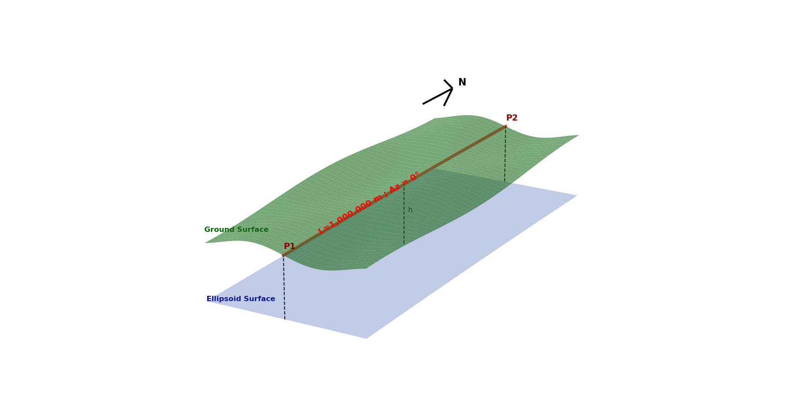

# LDP Quality Control & Validation Summary

This report provides a comparative analysis of distances calculated across various map projections and surfaces. By establishing the **Ground Distance (L2)** as the true baseline of length 1,000.000 meter, we measure the linear distortion introduced by standard UTM grids against the custom Low Distortion Projections (LDP).

<table>
<tr>
<td valign="top" width="30%">

## --- Distance Description ---

| Line   | Line Description                      |
|:-------|:--------------------------------------|
| L1     | on the ellipsoid surface              |
| L2     | on the ground surface , (HSF applied) |
| L3     | on the UTM grid                       |
| L4     | on the UTM grid (PSF applied)         |
| L5     | on the UTM grid (CSF applied)         |
| L6     | on the LDP grid                       |

### Maximum Magnitudes

| Projection | Maximum Value |
|:---|:---|
| P?_UTM_γ | -47' 52.59" |
| P?_LDP_γ | +6' 40.31" |
| P?_UTM_CSF | +823.0 ppm |
| P?_LDP_CSF | -20.5 ppm |

</td>
<td valign="top" width="70%">

</td>
</tr>
</table>

---

### 🧭 Amnat Charoen 📄 [WKT](https://github.com/phisan-chula/2026-EIT_TH_LDP/blob/main/src/OUTPUT_LDP/TH_AC/TH_AC_LDP_CRS.WKT) &emsp; 🌐 [PROJ4](https://github.com/phisan-chula/2026-EIT_TH_LDP/blob/main/src/OUTPUT_LDP/TH_AC/TH_AC_LDP_CRS.PJ4)

> **TH.AC LDP :**
> `+proj=tmerc +lat_0=15.88333333 +lon_0=104.75000000 +k_0=1.000016 +x_0=56000 +y_0=322000 +ellps=WGS84 +units=m +no_defs +type=crs`

| P1 | (15.908945085, 104.730609023) | P2 | (15.917981953, 104.730609023) |
|:---|:---|:---|:---|
| MSL | 186 | HAE | 163 |
| P1_U48 | (471164.328, 1758882.013) | P2_U48 | (471165.617, 1759881.623) |
| P1_LDP | (53923.528, 324834.278) | P2_LDP | (53923.621, 325834.294) |
| P1_U48_γ | -4' 25.84" | P2_U48_γ | -4' 25.98" |
| P1_LDP_γ | -0' 19.13" | P2_LDP_γ | -0' 19.15" |
| P1_U48_CSF | -415.5 ppm | P2_U48_CSF | -415.2 ppm |
| P1_LDP_CSF | -9.8 ppm | P2_LDP_CSF | -9.4 ppm |

| ΔL1_ELLP | ΔL2_GRND | ΔL3_UTM | ΔL4_UTM_PSF | ΔL5_UTM_CSF | ΔL6_LDP |
|:---:|:---:|:---:|:---:|:---:|:---:|
| -0.026 | *0.000 | -0.415 | -0.026 | -0.000 | -0.010 |

---

### 🧭 Ang Thong 📄 [WKT](https://github.com/phisan-chula/2026-EIT_TH_LDP/blob/main/src/OUTPUT_LDP/TH_AT/TH_AT_LDP_CRS.WKT) &emsp; 🌐 [PROJ4](https://github.com/phisan-chula/2026-EIT_TH_LDP/blob/main/src/OUTPUT_LDP/TH_AT/TH_AT_LDP_CRS.PJ4)

> **TH.AT LDP :**
> `+proj=tmerc +lat_0=14.61666667 +lon_0=100.35000000 +k_0=0.999997 +x_0=32000 +y_0=77000 +ellps=WGS84 +units=m +no_defs +type=crs`

| P1 | (14.618255615, 100.353729586) | P2 | (14.627293523, 100.353729586) |
|:---|:---|:---|:---|
| MSL | 6 | HAE | -26 |
| P1_U47 | (645802.939, 1616538.838) | P2_U47 | (645796.974, 1617538.683) |
| P1_LDP | (32401.820, 77175.812) | P2_LDP | (32401.804, 78175.809) |
| P1_U47_γ | +20' 30.16" | P2_U47_γ | +20' 30.91" |
| P1_LDP_γ | +0' 3.39" | P2_LDP_γ | +0' 3.39" |
| P1_U47_CSF | -133.1 ppm | P2_U47_CSF | -133.0 ppm |
| P1_LDP_CSF | +1.0 ppm | P2_LDP_CSF | +1.1 ppm |

| ΔL1_ELLP | ΔL2_GRND | ΔL3_UTM | ΔL4_UTM_PSF | ΔL5_UTM_CSF | ΔL6_LDP |
|:---:|:---:|:---:|:---:|:---:|:---:|
| +0.004 | *0.000 | -0.133 | +0.004 | -0.000 | +0.001 |

---

### 🧭 Bueng Kan 📄 [WKT](https://github.com/phisan-chula/2026-EIT_TH_LDP/blob/main/src/OUTPUT_LDP/TH_BK/TH_BK_LDP_CRS.WKT) &emsp; 🌐 [PROJ4](https://github.com/phisan-chula/2026-EIT_TH_LDP/blob/main/src/OUTPUT_LDP/TH_BK/TH_BK_LDP_CRS.PJ4)

> **TH.BK LDP :**
> `+proj=lcc +lat_1=18.15000000 +lat_0=18.15000000 +lon_0=103.71666667 +k_0=1.000022 +x_0=55000 +y_0=330000 +ellps=WGS84 +units=m +no_defs +type=crs`

| P1 | (18.107055664, 103.704676551) | P2 | (18.116090584, 103.704676551) |
|:---|:---|:---|:---|
| MSL | 177 | HAE | 147 |
| P1_U48 | (362947.165, 2002511.377) | P2_U48 | (362954.193, 2003511.184) |
| P1_LDP | (53730.927, 325246.777) | P2_LDP | (53730.992, 326246.800) |
| P1_U48_γ | -24' 9.51" | P2_U48_γ | -24' 10.21" |
| P1_LDP_γ | -0' 13.45" | P2_LDP_γ | -0' 13.45" |
| P1_U48_CSF | -190.3 ppm | P2_U48_CSF | -191.6 ppm |
| P1_LDP_CSF | -0.2 ppm | P2_LDP_CSF | -1.6 ppm |

| ΔL1_ELLP | ΔL2_GRND | ΔL3_UTM | ΔL4_UTM_PSF | ΔL5_UTM_CSF | ΔL6_LDP |
|:---:|:---:|:---:|:---:|:---:|:---:|
| -0.023 | *0.000 | -0.191 | -0.023 | -0.000 | -0.001 |

---

### 🧭 Buri Ram 📄 [WKT](https://github.com/phisan-chula/2026-EIT_TH_LDP/blob/main/src/OUTPUT_LDP/TH_BR/TH_BR_LDP_CRS.WKT) &emsp; 🌐 [PROJ4](https://github.com/phisan-chula/2026-EIT_TH_LDP/blob/main/src/OUTPUT_LDP/TH_BR/TH_BR_LDP_CRS.PJ4)

> **TH.BR LDP :**
> `+proj=tmerc +lat_0=14.81666667 +lon_0=102.96666667 +k_0=1.000012 +x_0=325000 +y_0=759000 +ellps=WGS84 +units=m +no_defs +type=crs`

| P1 | (14.961830616, 103.065677419) | P2 | (14.970868255, 103.065677419) |
|:---|:---|:---|:---|
| MSL | 159 | HAE | 133 |
| P1_U48 | (291974.551, 1655011.131) | P2_U48 | (291983.274, 1656011.229) |
| P1_LDP | (335650.673, 775064.615) | P2_LDP | (335650.227, 776064.628) |
| P1_U48_γ | -29' 58.47" | P2_U48_γ | -29' 59.53" |
| P1_LDP_γ | +1' 32.02" | P2_LDP_γ | +1' 32.08" |
| P1_U48_CSF | +114.0 ppm | P2_U48_CSF | +114.6 ppm |
| P1_LDP_CSF | -7.9 ppm | P2_LDP_CSF | -7.2 ppm |

| ΔL1_ELLP | ΔL2_GRND | ΔL3_UTM | ΔL4_UTM_PSF | ΔL5_UTM_CSF | ΔL6_LDP |
|:---:|:---:|:---:|:---:|:---:|:---:|
| -0.021 | *0.000 | +0.114 | -0.021 | -0.000 | -0.008 |

---

### 🧭 Chon Buri 📄 [WKT](https://github.com/phisan-chula/2026-EIT_TH_LDP/blob/main/src/OUTPUT_LDP/TH_CB/TH_CB_LDP_CRS.WKT) &emsp; 🌐 [PROJ4](https://github.com/phisan-chula/2026-EIT_TH_LDP/blob/main/src/OUTPUT_LDP/TH_CB/TH_CB_LDP_CRS.PJ4)

> **TH.CB LDP :**
> `+proj=tmerc +lat_0=13.20000000 +lon_0=101.20000000 +k_0=0.999997 +x_0=47000 +y_0=336000 +ellps=WGS84 +units=m +no_defs +type=crs`

| P1 | (13.096534500, 101.226437609) | P2 | (13.105573529, 101.226437609) |
|:---|:---|:---|:---|
| MSL | 102 | HAE | 74 |
| P1_U47 | (741399.156, 1448874.311) | P2_U47 | (741390.341, 1449874.593) |
| P1_LDP | (49866.957, 324553.615) | P2_LDP | (49866.852, 325553.612) |
| P1_U47_γ | +30' 17.06" | P2_U47_γ | +30' 18.29" |
| P1_LDP_γ | +0' 21.57" | P2_LDP_γ | +0' 21.58" |
| P1_U47_CSF | +309.2 ppm | P2_U47_CSF | +309.2 ppm |
| P1_LDP_CSF | -14.6 ppm | P2_LDP_CSF | -14.5 ppm |

| ΔL1_ELLP | ΔL2_GRND | ΔL3_UTM | ΔL4_UTM_PSF | ΔL5_UTM_CSF | ΔL6_LDP |
|:---:|:---:|:---:|:---:|:---:|:---:|
| -0.012 | *0.000 | +0.309 | -0.012 | -0.000 | -0.015 |

---

### 🧭 Chachoengsao 📄 [WKT](https://github.com/phisan-chula/2026-EIT_TH_LDP/blob/main/src/OUTPUT_LDP/TH_CC/TH_CC_LDP_CRS.WKT) &emsp; 🌐 [PROJ4](https://github.com/phisan-chula/2026-EIT_TH_LDP/blob/main/src/OUTPUT_LDP/TH_CC/TH_CC_LDP_CRS.PJ4)

> **TH.CC LDP :**
> `+proj=lcc +lat_1=13.60000000 +lat_0=13.60000000 +lon_0=101.43333333 +k_0=0.999996 +x_0=327000 +y_0=778000 +ellps=WGS84 +units=m +no_defs +type=crs`

| P1 | (13.576500894, 101.564268898) | P2 | (13.585539581, 101.564268898) |
|:---|:---|:---|:---|
| MSL | 36 | HAE | 10 |
| P1_U47 | (777499.972, 1502348.628) | P2_U47 | (777489.450, 1503349.125) |
| P1_LDP | (341170.956, 775403.980) | P2_LDP | (341170.418, 776403.976) |
| P1_U47_γ | +36' 8.40" | P2_U47_γ | +36' 9.81" |
| P1_LDP_γ | +1' 50.84" | P2_LDP_γ | +1' 50.84" |
| P1_U47_CSF | +551.5 ppm | P2_U47_CSF | +550.8 ppm |
| P1_LDP_CSF | -5.1 ppm | P2_LDP_CSF | -5.8 ppm |

| ΔL1_ELLP | ΔL2_GRND | ΔL3_UTM | ΔL4_UTM_PSF | ΔL5_UTM_CSF | ΔL6_LDP |
|:---:|:---:|:---:|:---:|:---:|:---:|
| -0.002 | *0.000 | +0.551 | -0.002 | -0.000 | -0.005 |

---

### 🧭 Chiang Mai Central 📄 [WKT](https://github.com/phisan-chula/2026-EIT_TH_LDP/blob/main/src/OUTPUT_LDP/TH_CM_C/TH_CM_C_LDP_CRS.WKT) &emsp; 🌐 [PROJ4](https://github.com/phisan-chula/2026-EIT_TH_LDP/blob/main/src/OUTPUT_LDP/TH_CM_C/TH_CM_C_LDP_CRS.PJ4)

> **TH.CM_C LDP :**
> `+proj=lcc +lat_1=18.70000000 +lat_0=18.70000000 +lon_0=98.65000000 +k_0=1.000043 +x_0=316000 +y_0=781000 +ellps=WGS84 +units=m +no_defs +type=crs`

| P1 | (18.783956386, 98.996828708) | P2 | (18.792990662, 98.996828708) |
|:---|:---|:---|:---|
| MSL | 307 | HAE | 269 |
| P1_U47 | (499665.793, 2076922.983) | P2_U47 | (499665.811, 2077922.583) |
| P1_LDP | (352566.751, 790328.935) | P2_LDP | (352564.810, 791328.978) |
| P1_U47_γ | -0' 3.68" | P2_U47_γ | -0' 3.68" |
| P1_LDP_γ | +6' 40.31" | P2_LDP_γ | +6' 40.31" |
| P1_U47_CSF | -442.2 ppm | P2_U47_CSF | -442.3 ppm |
| P1_LDP_CSF | +1.9 ppm | P2_LDP_CSF | +2.0 ppm |

| ΔL1_ELLP | ΔL2_GRND | ΔL3_UTM | ΔL4_UTM_PSF | ΔL5_UTM_CSF | ΔL6_LDP |
|:---:|:---:|:---:|:---:|:---:|:---:|
| -0.042 | *0.000 | -0.442 | -0.042 | -0.000 | +0.002 |

---

### 🧭 Chiang Mai North 📄 [WKT](https://github.com/phisan-chula/2026-EIT_TH_LDP/blob/main/src/OUTPUT_LDP/TH_CM_N/TH_CM_N_LDP_CRS.WKT) &emsp; 🌐 [PROJ4](https://github.com/phisan-chula/2026-EIT_TH_LDP/blob/main/src/OUTPUT_LDP/TH_CM_N/TH_CM_N_LDP_CRS.PJ4)

> **TH.CM_N LDP :**
> `+proj=tmerc +lat_0=19.51666667 +lon_0=99.01666667 +k_0=1.000063 +x_0=325000 +y_0=769000 +ellps=WGS84 +units=m +no_defs +type=crs`

| P1 | (19.571161271, 98.919901123) | P2 | (19.580194773, 98.919901123) |
|:---|:---|:---|:---|
| MSL | 534 | HAE | 496 |
| P1_U47 | (491598.780, 2164029.119) | P2_U47 | (491599.249, 2165028.719) |
| P1_LDP | (314845.984, 775035.731) | P2_LDP | (314846.550, 776035.795) |
| P1_U47_γ | -1' 36.59" | P2_U47_γ | -1' 36.64" |
| P1_LDP_γ | -1' 56.69" | P2_LDP_γ | -1' 56.74" |
| P1_U47_CSF | -472.2 ppm | P2_U47_CSF | -481.7 ppm |
| P1_LDP_CSF | -8.9 ppm | P2_LDP_CSF | -18.4 ppm |

| ΔL1_ELLP | ΔL2_GRND | ΔL3_UTM | ΔL4_UTM_PSF | ΔL5_UTM_CSF | ΔL6_LDP |
|:---:|:---:|:---:|:---:|:---:|:---:|
| -0.078 | *0.000 | -0.477 | -0.078 | -0.000 | -0.014 |

---

### 🧭 Chiang Mai South 📄 [WKT](https://github.com/phisan-chula/2026-EIT_TH_LDP/blob/main/src/OUTPUT_LDP/TH_CM_S/TH_CM_S_LDP_CRS.WKT) &emsp; 🌐 [PROJ4](https://github.com/phisan-chula/2026-EIT_TH_LDP/blob/main/src/OUTPUT_LDP/TH_CM_S/TH_CM_S_LDP_CRS.PJ4)

> **TH.CM_S LDP :**
> `+proj=tmerc +lat_0=17.85000000 +lon_0=98.43333333 +k_0=1.000139 +x_0=54000 +y_0=333000 +ellps=WGS84 +units=m +no_defs +type=crs`

| P1 | (17.777851105, 98.327666178) | P2 | (17.786886331, 98.327666178) |
|:---|:---|:---|:---|
| MSL | 989 | HAE | 951 |
| P1_U47 | (428735.051, 1965735.801) | P2_U47 | (428738.633, 1966735.458) |
| P1_LDP | (42793.831, 325016.730) | P2_LDP | (42794.394, 326016.870) |
| P1_U47_γ | -12' 19.05" | P2_U47_γ | -12' 19.41" |
| P1_LDP_γ | -1' 56.15" | P2_LDP_γ | -1' 56.20" |
| P1_U47_CSF | -498.2 ppm | P2_U47_CSF | -475.1 ppm |
| P1_LDP_CSF | -20.5 ppm ❗ | P2_LDP_CSF | +2.6 ppm |

| ΔL1_ELLP | ΔL2_GRND | ΔL3_UTM | ΔL4_UTM_PSF | ΔL5_UTM_CSF | ΔL6_LDP |
|:---:|:---:|:---:|:---:|:---:|:---:|
| -0.149 | *0.000 | -0.487 | -0.149 | -0.000 | -0.009 |

---

### 🧭 Chai Nat 📄 [WKT](https://github.com/phisan-chula/2026-EIT_TH_LDP/blob/main/src/OUTPUT_LDP/TH_CN/TH_CN_LDP_CRS.WKT) &emsp; 🌐 [PROJ4](https://github.com/phisan-chula/2026-EIT_TH_LDP/blob/main/src/OUTPUT_LDP/TH_CN/TH_CN_LDP_CRS.PJ4)

> **TH.CN LDP :**
> `+proj=lcc +lat_1=15.13333333 +lat_0=15.13333333 +lon_0=100.03333333 +k_0=0.999999 +x_0=55000 +y_0=322000 +ellps=WGS84 +units=m +no_defs +type=crs`

| P1 | (15.159755708, 100.038590182) | P2 | (15.168793189, 100.038590182) |
|:---|:---|:---|:---|
| MSL | 15 | HAE | -18 |
| P1_U47 | (611578.181, 1676260.290) | P2_U47 | (611573.440, 1677260.032) |
| P1_LDP | (55564.955, 324923.643) | P2_LDP | (55564.931, 325923.642) |
| P1_U47_γ | +16' 17.87" | P2_U47_γ | +16' 18.44" |
| P1_LDP_γ | +0' 4.94" | P2_LDP_γ | +0' 4.94" |
| P1_U47_CSF | -243.2 ppm | P2_U47_CSF | -243.3 ppm |
| P1_LDP_CSF | +1.9 ppm | P2_LDP_CSF | +2.0 ppm |

| ΔL1_ELLP | ΔL2_GRND | ΔL3_UTM | ΔL4_UTM_PSF | ΔL5_UTM_CSF | ΔL6_LDP |
|:---:|:---:|:---:|:---:|:---:|:---:|
| +0.003 | *0.000 | -0.243 | +0.003 | -0.000 | +0.002 |

---

### 🧭 Chumphon 📄 [WKT](https://github.com/phisan-chula/2026-EIT_TH_LDP/blob/main/src/OUTPUT_LDP/TH_CP/TH_CP_LDP_CRS.WKT) &emsp; 🌐 [PROJ4](https://github.com/phisan-chula/2026-EIT_TH_LDP/blob/main/src/OUTPUT_LDP/TH_CP/TH_CP_LDP_CRS.PJ4)

> **TH.CP LDP :**
> `+proj=tmerc +lat_0=10.35000000 +lon_0=99.06666667 +k_0=1.000003 +x_0=55000 +y_0=329000 +ellps=WGS84 +units=m +no_defs +type=crs`

| P1 | (10.495293501, 99.182428377) | P2 | (10.504334180, 99.182428377) |
|:---|:---|:---|:---|
| MSL | 5 | HAE | -23 |
| P1_U47 | (519962.343, 1160180.500) | P2_U47 | (519961.763, 1161180.105) |
| P1_LDP | (67672.395, 345073.385) | P2_LDP | (67672.026, 346073.390) |
| P1_U47_γ | +1' 59.63" | P2_U47_γ | +1' 59.73" |
| P1_LDP_γ | +1' 15.91" | P2_LDP_γ | +1' 15.98" |
| P1_U47_CSF | -391.4 ppm | P2_U47_CSF | -391.5 ppm |
| P1_LDP_CSF | +8.6 ppm | P2_LDP_CSF | +8.6 ppm |

| ΔL1_ELLP | ΔL2_GRND | ΔL3_UTM | ΔL4_UTM_PSF | ΔL5_UTM_CSF | ΔL6_LDP |
|:---:|:---:|:---:|:---:|:---:|:---:|
| +0.004 | *0.000 | -0.391 | +0.004 | -0.000 | +0.009 |

---

### 🧭 Chiang Rai 📄 [WKT](https://github.com/phisan-chula/2026-EIT_TH_LDP/blob/main/src/OUTPUT_LDP/TH_CR/TH_CR_LDP_CRS.WKT) &emsp; 🌐 [PROJ4](https://github.com/phisan-chula/2026-EIT_TH_LDP/blob/main/src/OUTPUT_LDP/TH_CR/TH_CR_LDP_CRS.PJ4)

> **TH.CR LDP :**
> `+proj=tmerc +lat_0=19.85000000 +lon_0=99.86666667 +k_0=1.000051 +x_0=320000 +y_0=788000 +ellps=WGS84 +units=m +no_defs +type=crs`

| P1 | (19.730527000, 99.884747529) | P2 | (19.739560342, 99.884747529) |
|:---|:---|:---|:---|
| MSL | 449 | HAE | 412 |
| P1_U47 | (592708.551, 2181903.537) | P2_U47 | (592703.338, 2182903.230) |
| P1_LDP | (321895.405, 774773.564) | P2_LDP | (321895.298, 775773.615) |
| P1_U47_γ | +17' 55.35" | P2_U47_γ | +17' 55.83" |
| P1_LDP_γ | +0' 21.97" | P2_LDP_γ | +0' 21.98" |
| P1_U47_CSF | -354.8 ppm | P2_U47_CSF | -362.1 ppm |
| P1_LDP_CSF | -10.0 ppm | P2_LDP_CSF | -17.3 ppm |

| ΔL1_ELLP | ΔL2_GRND | ΔL3_UTM | ΔL4_UTM_PSF | ΔL5_UTM_CSF | ΔL6_LDP |
|:---:|:---:|:---:|:---:|:---:|:---:|
| -0.065 | *0.000 | -0.358 | -0.065 | -0.000 | -0.014 |

---

### 🧭 Chanthaburi 📄 [WKT](https://github.com/phisan-chula/2026-EIT_TH_LDP/blob/main/src/OUTPUT_LDP/TH_CT/TH_CT_LDP_CRS.WKT) &emsp; 🌐 [PROJ4](https://github.com/phisan-chula/2026-EIT_TH_LDP/blob/main/src/OUTPUT_LDP/TH_CT/TH_CT_LDP_CRS.PJ4)

> **TH.CT LDP :**
> `+proj=tmerc +lat_0=12.88333333 +lon_0=102.13333333 +k_0=1.000006 +x_0=57000 +y_0=332000 +ellps=WGS84 +units=m +no_defs +type=crs`

| P1 | (12.606762681, 102.109444341) | P2 | (12.615802047, 102.109444341) |
|:---|:---|:---|:---|
| MSL | 9 | HAE | -15 |
| P1_U48 | (185936.673, 1395379.908) | P2_U48 | (185947.706, 1396380.668) |
| P1_LDP | (54404.374, 301403.383) | P2_LDP | (54404.465, 302403.389) |
| P1_U48_γ | -37' 53.07" | P2_U48_γ | -37' 54.67" |
| P1_LDP_γ | -0' 18.77" | P2_LDP_γ | -0' 18.78" |
| P1_U48_CSF | +823.0 ppm | P2_U48_CSF | +822.4 ppm |
| P1_LDP_CSF | +8.7 ppm | P2_LDP_CSF | +8.1 ppm |

| ΔL1_ELLP | ΔL2_GRND | ΔL3_UTM | ΔL4_UTM_PSF | ΔL5_UTM_CSF | ΔL6_LDP |
|:---:|:---:|:---:|:---:|:---:|:---:|
| +0.002 | *0.000 | +0.823 | +0.002 | -0.000 | +0.008 |

---

### 🧭 Chaiyaphum 📄 [WKT](https://github.com/phisan-chula/2026-EIT_TH_LDP/blob/main/src/OUTPUT_LDP/TH_CY/TH_CY_LDP_CRS.WKT) &emsp; 🌐 [PROJ4](https://github.com/phisan-chula/2026-EIT_TH_LDP/blob/main/src/OUTPUT_LDP/TH_CY/TH_CY_LDP_CRS.PJ4)

> **TH.CY LDP :**
> `+proj=tmerc +lat_0=16.03333333 +lon_0=101.81666667 +k_0=1.000017 +x_0=318000 +y_0=776000 +ellps=WGS84 +units=m +no_defs +type=crs`

| P1 | (16.021924973, 101.842337611) | P2 | (16.030961746, 101.842337611) |
|:---|:---|:---|:---|
| MSL | 237 | HAE | 207 |
| P1_U47 | (804179.465, 1773444.260) | P2_U47 | (804165.749, 1774444.910) |
| P1_LDP | (320747.420, 774737.711) | P2_LDP | (320747.297, 775737.728) |
| P1_U47_γ | +47' 6.38" | P2_U47_γ | +47' 7.93" |
| P1_LDP_γ | +0' 25.51" | P2_LDP_γ | +0' 25.52" |
| P1_U47_CSF | +712.0 ppm | P2_U47_CSF | +711.6 ppm |
| P1_LDP_CSF | -15.3 ppm | P2_LDP_CSF | -15.5 ppm |

| ΔL1_ELLP | ΔL2_GRND | ΔL3_UTM | ΔL4_UTM_PSF | ΔL5_UTM_CSF | ΔL6_LDP |
|:---:|:---:|:---:|:---:|:---:|:---:|
| -0.033 | *0.000 | +0.712 | -0.033 | -0.000 | -0.015 |

---

### 🧭 GreaterBKK 📄 [WKT](https://github.com/phisan-chula/2026-EIT_TH_LDP/blob/main/src/OUTPUT_LDP/TH_GBKK/TH_GBKK_LDP_CRS.WKT) &emsp; 🌐 [PROJ4](https://github.com/phisan-chula/2026-EIT_TH_LDP/blob/main/src/OUTPUT_LDP/TH_GBKK/TH_GBKK_LDP_CRS.PJ4)

> **TH.GBKK LDP :**
> `+proj=tmerc +lat_0=13.75000000 +lon_0=100.60000000 +k_0=0.999989 +x_0=53000 +y_0=318000 +ellps=WGS84 +units=m +no_defs +type=crs`

| P1 | (13.808650971, 100.630963241) | P2 | (13.817689489, 100.630963241) |
|:---|:---|:---|:---|
| MSL | 2 | HAE | -28 |
| P1_U47 | (676294.985, 1527163.229) | P2_U47 | (676288.187, 1528163.191) |
| P1_LDP | (56347.795, 324489.129) | P2_LDP | (56347.666, 325489.119) |
| P1_U47_γ | +23' 21.77" | P2_U47_γ | +23' 22.67" |
| P1_LDP_γ | +0' 26.61" | P2_LDP_γ | +0' 26.62" |
| P1_U47_CSF | -11.1 ppm | P2_U47_CSF | -11.2 ppm |
| P1_LDP_CSF | -6.4 ppm | P2_LDP_CSF | -6.5 ppm |

| ΔL1_ELLP | ΔL2_GRND | ΔL3_UTM | ΔL4_UTM_PSF | ΔL5_UTM_CSF | ΔL6_LDP |
|:---:|:---:|:---:|:---:|:---:|:---:|
| +0.004 | *0.000 | -0.011 | +0.004 | -0.000 | -0.006 |

---

### 🧭 Khon Kaen 📄 [WKT](https://github.com/phisan-chula/2026-EIT_TH_LDP/blob/main/src/OUTPUT_LDP/TH_KK/TH_KK_LDP_CRS.WKT) &emsp; 🌐 [PROJ4](https://github.com/phisan-chula/2026-EIT_TH_LDP/blob/main/src/OUTPUT_LDP/TH_KK/TH_KK_LDP_CRS.PJ4)

> **TH.KK LDP :**
> `+proj=tmerc +lat_0=16.40000000 +lon_0=102.58333333 +k_0=1.000010 +x_0=337000 +y_0=779000 +ellps=WGS84 +units=m +no_defs +type=crs`

| P1 | (16.359140397, 102.679125790) | P2 | (16.368176884, 102.679125790) |
|:---|:---|:---|:---|
| MSL | 167 | HAE | 138 |
| P1_U48 | (252076.991, 1810076.994) | P2_U48 | (252088.413, 1811077.289) |
| P1_LDP | (347234.679, 774480.733) | P2_LDP | (347234.208, 775480.744) |
| P1_U48_γ | -39' 14.50" | P2_U48_γ | -39' 15.76" |
| P1_LDP_γ | +1' 37.13" | P2_LDP_γ | +1' 37.18" |
| P1_U48_CSF | +338.2 ppm | P2_U48_CSF | +338.7 ppm |
| P1_LDP_CSF | -10.7 ppm | P2_LDP_CSF | -10.1 ppm |

| ΔL1_ELLP | ΔL2_GRND | ΔL3_UTM | ΔL4_UTM_PSF | ΔL5_UTM_CSF | ΔL6_LDP |
|:---:|:---:|:---:|:---:|:---:|:---:|
| -0.022 | *0.000 | +0.338 | -0.022 | -0.000 | -0.010 |

---

### 🧭 Kalasin 📄 [WKT](https://github.com/phisan-chula/2026-EIT_TH_LDP/blob/main/src/OUTPUT_LDP/TH_KL/TH_KL_LDP_CRS.WKT) &emsp; 🌐 [PROJ4](https://github.com/phisan-chula/2026-EIT_TH_LDP/blob/main/src/OUTPUT_LDP/TH_KL/TH_KL_LDP_CRS.PJ4)

> **TH.KL LDP :**
> `+proj=lcc +lat_1=16.63333333 +lat_0=16.63333333 +lon_0=103.61666667 +k_0=1.000010 +x_0=319000 +y_0=774000 +ellps=WGS84 +units=m +no_defs +type=crs`

| P1 | (16.639864923, 103.685787417) | P2 | (16.648901168, 103.685787417) |
|:---|:---|:---|:---|
| MSL | 198 | HAE | 171 |
| P1_U48 | (359836.192, 1840176.167) | P2_U48 | (359842.761, 1841175.989) |
| P1_LDP | (326374.367, 774724.101) | P2_LDP | (326374.021, 775724.111) |
| P1_U48_γ | -22' 35.02" | P2_U48_γ | -22' 35.73" |
| P1_LDP_γ | +1' 11.23" | P2_LDP_γ | +1' 11.23" |
| P1_U48_CSF | -183.1 ppm | P2_U48_CSF | -184.9 ppm |
| P1_LDP_CSF | -16.1 ppm | P2_LDP_CSF | -17.8 ppm |

| ΔL1_ELLP | ΔL2_GRND | ΔL3_UTM | ΔL4_UTM_PSF | ΔL5_UTM_CSF | ΔL6_LDP |
|:---:|:---:|:---:|:---:|:---:|:---:|
| -0.027 | *0.000 | -0.184 | -0.027 | -0.000 | -0.017 |

---

### 🧭 Kanchanaburi North 📄 [WKT](https://github.com/phisan-chula/2026-EIT_TH_LDP/blob/main/src/OUTPUT_LDP/TH_KN_N/TH_KN_N_LDP_CRS.WKT) &emsp; 🌐 [PROJ4](https://github.com/phisan-chula/2026-EIT_TH_LDP/blob/main/src/OUTPUT_LDP/TH_KN_N/TH_KN_N_LDP_CRS.PJ4)

> **TH.KN_N LDP :**
> `+proj=tmerc +lat_0=14.81666667 +lon_0=98.76666667 +k_0=1.000013 +x_0=325000 +y_0=766000 +ellps=WGS84 +units=m +no_defs +type=crs`

| P1 | (14.742796524, 98.631634064) | P2 | (14.751834335, 98.631634064) |
|:---|:---|:---|:---|
| MSL | 90 | HAE | 53 |
| P1_U47 | (460350.731, 1629910.903) | P2_U47 | (460352.367, 1630910.521) |
| P1_LDP | (310459.763, 757830.775) | P2_LDP | (310460.363, 758830.791) |
| P1_U47_γ | -5' 37.48" | P2_U47_γ | -5' 37.68" |
| P1_LDP_γ | -2' 3.71" | P2_LDP_γ | -2' 3.78" |
| P1_U47_CSF | -390.6 ppm | P2_U47_CSF | -387.3 ppm |
| P1_LDP_CSF | +5.6 ppm | P2_LDP_CSF | +8.8 ppm |

| ΔL1_ELLP | ΔL2_GRND | ΔL3_UTM | ΔL4_UTM_PSF | ΔL5_UTM_CSF | ΔL6_LDP |
|:---:|:---:|:---:|:---:|:---:|:---:|
| -0.008 | *0.000 | -0.389 | -0.008 | -0.000 | +0.007 |

---

### 🧭 Kanchanaburi South 📄 [WKT](https://github.com/phisan-chula/2026-EIT_TH_LDP/blob/main/src/OUTPUT_LDP/TH_KN_S/TH_KN_S_LDP_CRS.WKT) &emsp; 🌐 [PROJ4](https://github.com/phisan-chula/2026-EIT_TH_LDP/blob/main/src/OUTPUT_LDP/TH_KN_S/TH_KN_S_LDP_CRS.PJ4)

> **TH.KN_S LDP :**
> `+proj=tmerc +lat_0=14.23333333 +lon_0=99.45000000 +k_0=0.999995 +x_0=333000 +y_0=769000 +ellps=WGS84 +units=m +no_defs +type=crs`

| P1 | (14.285061837, 99.440797329) | P2 | (14.294100000, 99.440797329) |
|:---|:---|:---|:---|
| MSL | 103 | HAE | 69 |
| P1_U47 | (547543.199, 1579298.229) | P2_U47 | (547541.300, 1580297.856) |
| P1_LDP | (332007.041, 774723.320) | P2_LDP | (332007.081, 775723.315) |
| P1_U47_γ | +6' 31.56" | P2_U47_γ | +6' 31.80" |
| P1_LDP_γ | -0' 8.17" | P2_LDP_γ | -0' 8.18" |
| P1_U47_CSF | -382.2 ppm | P2_U47_CSF | -383.6 ppm |
| P1_LDP_CSF | -15.1 ppm | P2_LDP_CSF | -16.6 ppm |

| ΔL1_ELLP | ΔL2_GRND | ΔL3_UTM | ΔL4_UTM_PSF | ΔL5_UTM_CSF | ΔL6_LDP |
|:---:|:---:|:---:|:---:|:---:|:---:|
| -0.011 | *0.000 | -0.383 | -0.011 | -0.000 | -0.016 |

---

### 🧭 Kamphaeng Phet 📄 [WKT](https://github.com/phisan-chula/2026-EIT_TH_LDP/blob/main/src/OUTPUT_LDP/TH_KP/TH_KP_LDP_CRS.WKT) &emsp; 🌐 [PROJ4](https://github.com/phisan-chula/2026-EIT_TH_LDP/blob/main/src/OUTPUT_LDP/TH_KP/TH_KP_LDP_CRS.PJ4)

> **TH.KP LDP :**
> `+proj=tmerc +lat_0=16.33333333 +lon_0=99.53333333 +k_0=0.999994 +x_0=326000 +y_0=770000 +ellps=WGS84 +units=m +no_defs +type=crs`

| P1 | (16.382061005, 99.511344260) | P2 | (16.391097473, 99.511344260) |
|:---|:---|:---|:---|
| MSL | 83 | HAE | 47 |
| P1_U47 | (554604.968, 1811266.315) | P2_U47 | (554602.451, 1812265.948) |
| P1_LDP | (323650.952, 775392.416) | P2_LDP | (323651.060, 776392.410) |
| P1_U47_γ | +8' 39.21" | P2_U47_γ | +8' 39.48" |
| P1_LDP_γ | -0' 22.33" | P2_LDP_γ | -0' 22.34" |
| P1_U47_CSF | -371.6 ppm | P2_U47_CSF | -369.4 ppm |
| P1_LDP_CSF | -14.4 ppm | P2_LDP_CSF | -12.2 ppm |

| ΔL1_ELLP | ΔL2_GRND | ΔL3_UTM | ΔL4_UTM_PSF | ΔL5_UTM_CSF | ΔL6_LDP |
|:---:|:---:|:---:|:---:|:---:|:---:|
| -0.007 | *0.000 | -0.371 | -0.007 | -0.000 | -0.013 |

---

### 🧭 Krabi 📄 [WKT](https://github.com/phisan-chula/2026-EIT_TH_LDP/blob/main/src/OUTPUT_LDP/TH_KR/TH_KR_LDP_CRS.WKT) &emsp; 🌐 [PROJ4](https://github.com/phisan-chula/2026-EIT_TH_LDP/blob/main/src/OUTPUT_LDP/TH_KR/TH_KR_LDP_CRS.PJ4)

> **TH.KR LDP :**
> `+proj=tmerc +lat_0=8.18333333 +lon_0=99.01666667 +k_0=1.000000 +x_0=55000 +y_0=327000 +ellps=WGS84 +units=m +no_defs +type=crs`

| P1 | (8.166850764, 99.021201992) | P2 | (8.175892624, 99.021201992) |
|:---|:---|:---|:---|
| MSL | 77 | HAE | 55 |
| P1_U47 | (502335.483, 902743.598) | P2_U47 | (502335.430, 903743.198) |
| P1_LDP | (55499.783, 325177.085) | P2_LDP | (55499.772, 326177.085) |
| P1_U47_γ | +0' 10.84" | P2_U47_γ | +0' 10.85" |
| P1_LDP_γ | +0' 2.32" | P2_LDP_γ | +0' 2.32" |
| P1_U47_CSF | -404.7 ppm | P2_U47_CSF | -412.4 ppm |
| P1_LDP_CSF | -4.8 ppm | P2_LDP_CSF | -12.5 ppm |

| ΔL1_ELLP | ΔL2_GRND | ΔL3_UTM | ΔL4_UTM_PSF | ΔL5_UTM_CSF | ΔL6_LDP |
|:---:|:---:|:---:|:---:|:---:|:---:|
| -0.009 | *0.000 | -0.409 | -0.009 | -0.000 | -0.009 |

---

### 🧭 Lop Buri 📄 [WKT](https://github.com/phisan-chula/2026-EIT_TH_LDP/blob/main/src/OUTPUT_LDP/TH_LB/TH_LB_LDP_CRS.WKT) &emsp; 🌐 [PROJ4](https://github.com/phisan-chula/2026-EIT_TH_LDP/blob/main/src/OUTPUT_LDP/TH_LB/TH_LB_LDP_CRS.PJ4)

> **TH.LB LDP :**
> `+proj=tmerc +lat_0=15.10000000 +lon_0=100.90000000 +k_0=0.999990 +x_0=323000 +y_0=773000 +ellps=WGS84 +units=m +no_defs +type=crs`

| P1 | (14.814306985, 100.646482240) | P2 | (14.823344740, 100.646482240) |
|:---|:---|:---|:---|
| MSL | 18 | HAE | -13 |
| P1_U47 | (677182.310, 1638438.748) | P2_U47 | (677174.959, 1639438.710) |
| P1_LDP | (295710.848, 741404.311) | P2_LDP | (295711.980, 742404.310) |
| P1_U47_γ | +25' 15.94" | P2_U47_γ | +25' 16.85" |
| P1_LDP_γ | -3' 53.36" | P2_LDP_γ | -3' 53.50" |
| P1_U47_CSF | -9.6 ppm | P2_U47_CSF | -9.7 ppm |
| P1_LDP_CSF | +1.4 ppm | P2_LDP_CSF | +1.2 ppm |

| ΔL1_ELLP | ΔL2_GRND | ΔL3_UTM | ΔL4_UTM_PSF | ΔL5_UTM_CSF | ΔL6_LDP |
|:---:|:---:|:---:|:---:|:---:|:---:|
| +0.002 | *0.000 | -0.010 | +0.002 | -0.000 | +0.001 |

---

### 🧭 Loei 📄 [WKT](https://github.com/phisan-chula/2026-EIT_TH_LDP/blob/main/src/OUTPUT_LDP/TH_LE/TH_LE_LDP_CRS.WKT) &emsp; 🌐 [PROJ4](https://github.com/phisan-chula/2026-EIT_TH_LDP/blob/main/src/OUTPUT_LDP/TH_LE/TH_LE_LDP_CRS.PJ4)

> **TH.LE LDP :**
> `+proj=tmerc +lat_0=17.40000000 +lon_0=101.63333333 +k_0=1.000033 +x_0=340000 +y_0=766000 +ellps=WGS84 +units=m +no_defs +type=crs`

| P1 | (17.484251500, 101.644848339) | P2 | (17.493286995, 101.644848339) |
|:---|:---|:---|:---|
| MSL | 281 | HAE | 250 |
| P1_U47 | (780875.520, 1935075.338) | P2_U47 | (780861.631, 1936075.817) |
| P1_LDP | (341223.033, 775324.804) | P2_LDP | (341222.973, 776324.837) |
| P1_U47_γ | +47' 42.54" | P2_U47_γ | +47' 43.98" |
| P1_LDP_γ | +0' 12.45" | P2_LDP_γ | +0' 12.46" |
| P1_U47_CSF | +535.6 ppm | P2_U47_CSF | +536.7 ppm |
| P1_LDP_CSF | -6.9 ppm | P2_LDP_CSF | -5.7 ppm |

| ΔL1_ELLP | ΔL2_GRND | ΔL3_UTM | ΔL4_UTM_PSF | ΔL5_UTM_CSF | ΔL6_LDP |
|:---:|:---:|:---:|:---:|:---:|:---:|
| -0.039 | *0.000 | +0.536 | -0.039 | -0.000 | -0.006 |

---

### 🧭 Lampang North 📄 [WKT](https://github.com/phisan-chula/2026-EIT_TH_LDP/blob/main/src/OUTPUT_LDP/TH_LG_N/TH_LG_N_LDP_CRS.WKT) &emsp; 🌐 [PROJ4](https://github.com/phisan-chula/2026-EIT_TH_LDP/blob/main/src/OUTPUT_LDP/TH_LG_N/TH_LG_N_LDP_CRS.PJ4)

> **TH.LG_N LDP :**
> `+proj=tmerc +lat_0=18.85000000 +lon_0=99.70000000 +k_0=1.000045 +x_0=52000 +y_0=314000 +ellps=WGS84 +units=m +no_defs +type=crs`

| P1 | (18.950120867, 99.664755489) | P2 | (18.959154982, 99.664755489) |
|:---|:---|:---|:---|
| MSL | 387 | HAE | 350 |
| P1_U47 | (569987.512, 2095440.302) | P2_U47 | (569983.744, 2096439.956) |
| P1_LDP | (48287.763, 325083.336) | P2_LDP | (48287.963, 326083.381) |
| P1_U47_γ | +12' 57.19" | P2_U47_γ | +12' 57.54" |
| P1_LDP_γ | -0' 41.20" | P2_LDP_γ | -0' 41.22" |
| P1_U47_CSF | -395.9 ppm | P2_U47_CSF | -393.1 ppm |
| P1_LDP_CSF | -11.3 ppm | P2_LDP_CSF | -8.5 ppm |

| ΔL1_ELLP | ΔL2_GRND | ΔL3_UTM | ΔL4_UTM_PSF | ΔL5_UTM_CSF | ΔL6_LDP |
|:---:|:---:|:---:|:---:|:---:|:---:|
| -0.055 | *0.000 | -0.395 | -0.055 | -0.000 | -0.010 |

---

### 🧭 Lampang South 📄 [WKT](https://github.com/phisan-chula/2026-EIT_TH_LDP/blob/main/src/OUTPUT_LDP/TH_LG_S/TH_LG_S_LDP_CRS.WKT) &emsp; 🌐 [PROJ4](https://github.com/phisan-chula/2026-EIT_TH_LDP/blob/main/src/OUTPUT_LDP/TH_LG_S/TH_LG_S_LDP_CRS.PJ4)

> **TH.LG_S LDP :**
> `+proj=tmerc +lat_0=18.03333333 +lon_0=99.40000000 +k_0=1.000027 +x_0=318000 +y_0=785000 +ellps=WGS84 +units=m +no_defs +type=crs`

| P1 | (17.940085501, 99.312005600) | P2 | (17.949120576, 99.312005600) |
|:---|:---|:---|:---|
| MSL | 253 | HAE | 215 |
| P1_U47 | (533041.000, 1983584.566) | P2_U47 | (533039.323, 1984584.178) |
| P1_LDP | (308677.558, 774681.234) | P2_LDP | (308678.031, 775681.262) |
| P1_U47_γ | +5' 45.98" | P2_U47_γ | +5' 46.15" |
| P1_LDP_γ | -1' 37.58" | P2_LDP_γ | -1' 37.62" |
| P1_U47_CSF | -417.2 ppm | P2_U47_CSF | -423.5 ppm |
| P1_LDP_CSF | -2.7 ppm | P2_LDP_CSF | -8.9 ppm |

| ΔL1_ELLP | ΔL2_GRND | ΔL3_UTM | ΔL4_UTM_PSF | ΔL5_UTM_CSF | ΔL6_LDP |
|:---:|:---:|:---:|:---:|:---:|:---:|
| -0.034 | *0.000 | -0.420 | -0.034 | -0.000 | -0.006 |

---

### 🧭 Lamphun 📄 [WKT](https://github.com/phisan-chula/2026-EIT_TH_LDP/blob/main/src/OUTPUT_LDP/TH_LN/TH_LN_LDP_CRS.WKT) &emsp; 🌐 [PROJ4](https://github.com/phisan-chula/2026-EIT_TH_LDP/blob/main/src/OUTPUT_LDP/TH_LN/TH_LN_LDP_CRS.PJ4)

> **TH.LN LDP :**
> `+proj=tmerc +lat_0=18.11666667 +lon_0=98.95000000 +k_0=1.000052 +x_0=50000 +y_0=331000 +ellps=WGS84 +units=m +no_defs +type=crs`

| P1 | (18.572154410, 99.016480438) | P2 | (18.581188890, 99.016480438) |
|:---|:---|:---|:---|
| MSL | 293 | HAE | 255 |
| P1_U47 | (501738.949, 2053488.447) | P2_U47 | (501738.858, 2054488.047) |
| P1_LDP | (57017.921, 381419.285) | P2_LDP | (57017.551, 382419.338) |
| P1_U47_γ | +0' 18.90" | P2_U47_γ | +0' 18.91" |
| P1_LDP_γ | +1' 16.23" | P2_LDP_γ | +1' 16.26" |
| P1_U47_CSF | -440.1 ppm | P2_U47_CSF | -439.9 ppm |
| P1_LDP_CSF | +12.5 ppm | P2_LDP_CSF | +12.6 ppm |

| ΔL1_ELLP | ΔL2_GRND | ΔL3_UTM | ΔL4_UTM_PSF | ΔL5_UTM_CSF | ΔL6_LDP |
|:---:|:---:|:---:|:---:|:---:|:---:|
| -0.040 | *0.000 | -0.440 | -0.040 | -0.000 | +0.013 |

---

### 🧭 Mukdahan North 📄 [WKT](https://github.com/phisan-chula/2026-EIT_TH_LDP/blob/main/src/OUTPUT_LDP/TH_MD_N/TH_MD_N_LDP_CRS.WKT) &emsp; 🌐 [PROJ4](https://github.com/phisan-chula/2026-EIT_TH_LDP/blob/main/src/OUTPUT_LDP/TH_MD_N/TH_MD_N_LDP_CRS.PJ4)

> **TH.MD_N LDP :**
> `+proj=tmerc +lat_0=16.68333333 +lon_0=104.35000000 +k_0=1.000030 +x_0=53000 +y_0=333000 +ellps=WGS84 +units=m +no_defs +type=crs`

| P1 | (16.586237947, 104.414155530) | P2 | (16.595274239, 104.414155530) |
|:---|:---|:---|:---|
| MSL | 176 | HAE | 152 |
| P1_U48 | (437504.685, 1833874.742) | P2_U48 | (437507.604, 1834874.386) |
| P1_LDP | (59846.675, 322255.679) | P2_LDP | (59846.355, 323255.710) |
| P1_U48_γ | -10' 2.06" | P2_U48_γ | -10' 2.38" |
| P1_LDP_γ | +1' 5.93" | P2_LDP_γ | +1' 5.96" |
| P1_U48_CSF | -375.1 ppm | P2_U48_CSF | -375.9 ppm |
| P1_LDP_CSF | +7.1 ppm | P2_LDP_CSF | +6.4 ppm |

| ΔL1_ELLP | ΔL2_GRND | ΔL3_UTM | ΔL4_UTM_PSF | ΔL5_UTM_CSF | ΔL6_LDP |
|:---:|:---:|:---:|:---:|:---:|:---:|
| -0.024 | *0.000 | -0.376 | -0.024 | -0.000 | +0.007 |

---

### 🧭 Mukdahan South 📄 [WKT](https://github.com/phisan-chula/2026-EIT_TH_LDP/blob/main/src/OUTPUT_LDP/TH_MD_S/TH_MD_S_LDP_CRS.WKT) &emsp; 🌐 [PROJ4](https://github.com/phisan-chula/2026-EIT_TH_LDP/blob/main/src/OUTPUT_LDP/TH_MD_S/TH_MD_S_LDP_CRS.PJ4)

> **TH.MD_S LDP :**
> `+proj=tmerc +lat_0=16.46666667 +lon_0=104.66666667 +k_0=1.000025 +x_0=52000 +y_0=321000 +ellps=WGS84 +units=m +no_defs +type=crs`

| P1 | (16.505025864, 104.602207551) | P2 | (16.514062226, 104.602207551) |
|:---|:---|:---|:---|
| MSL | 176 | HAE | 152 |
| P1_U48 | (457547.822, 1824841.712) | P2_U48 | (457549.794, 1825841.333) |
| P1_LDP | (45118.081, 325246.178) | P2_LDP | (45118.401, 326246.204) |
| P1_U48_γ | -6' 46.85" | P2_U48_γ | -6' 47.07" |
| P1_LDP_γ | -1' 5.93" | P2_LDP_γ | -1' 5.96" |
| P1_U48_CSF | -402.4 ppm | P2_U48_CSF | -400.9 ppm |
| P1_LDP_CSF | +0.9 ppm | P2_LDP_CSF | +2.4 ppm |

| ΔL1_ELLP | ΔL2_GRND | ΔL3_UTM | ΔL4_UTM_PSF | ΔL5_UTM_CSF | ΔL6_LDP |
|:---:|:---:|:---:|:---:|:---:|:---:|
| -0.024 | *0.000 | -0.402 | -0.024 | -0.000 | +0.002 |

---

### 🧭 Mae Hong Son Central 📄 [WKT](https://github.com/phisan-chula/2026-EIT_TH_LDP/blob/main/src/OUTPUT_LDP/TH_MH_C/TH_MH_C_LDP_CRS.WKT) &emsp; 🌐 [PROJ4](https://github.com/phisan-chula/2026-EIT_TH_LDP/blob/main/src/OUTPUT_LDP/TH_MH_C/TH_MH_C_LDP_CRS.PJ4)

> **TH.MH_C LDP :**
> `+proj=tmerc +lat_0=18.93333333 +lon_0=97.96666667 +k_0=1.000042 +x_0=55000 +y_0=322000 +ellps=WGS84 +units=m +no_defs +type=crs`

| P1 | (19.300496250, 97.963533491) | P2 | (19.309530021, 97.963533491) |
|:---|:---|:---|:---|
| MSL | 262 | HAE | 222 |
| P1_U47 | (391104.652, 2134402.812) | P2_U47 | (391110.631, 2135402.541) |
| P1_LDP | (54670.684, 362644.249) | P2_LDP | (54670.702, 363644.291) |
| P1_U47_γ | -20' 33.39" | P2_U47_γ | -20' 33.95" |
| P1_LDP_γ | -0' 3.73" | P2_LDP_γ | -0' 3.73" |
| P1_U47_CSF | -290.0 ppm | P2_U47_CSF | -286.6 ppm |
| P1_LDP_CSF | +5.4 ppm | P2_LDP_CSF | +8.8 ppm |

| ΔL1_ELLP | ΔL2_GRND | ΔL3_UTM | ΔL4_UTM_PSF | ΔL5_UTM_CSF | ΔL6_LDP |
|:---:|:---:|:---:|:---:|:---:|:---:|
| -0.035 | *0.000 | -0.288 | -0.035 | -0.000 | +0.007 |

---

### 🧭 Mae Hong Son North 📄 [WKT](https://github.com/phisan-chula/2026-EIT_TH_LDP/blob/main/src/OUTPUT_LDP/TH_MH_N/TH_MH_N_LDP_CRS.WKT) &emsp; 🌐 [PROJ4](https://github.com/phisan-chula/2026-EIT_TH_LDP/blob/main/src/OUTPUT_LDP/TH_MH_N/TH_MH_N_LDP_CRS.PJ4)

> **TH.MH_N LDP :**
> `+proj=tmerc +lat_0=19.40000000 +lon_0=98.35000000 +k_0=1.000088 +x_0=56000 +y_0=323000 +ellps=WGS84 +units=m +no_defs +type=crs`

| P1 | (19.358857921, 98.439331403) | P2 | (19.367891634, 98.439331403) |
|:---|:---|:---|:---|
| MSL | 505 | HAE | 466 |
| P1_U47 | (441116.605, 2140630.566) | P2_U47 | (441119.848, 2141630.203) |
| P1_LDP | (65386.365, 318447.735) | P2_LDP | (65385.848, 319447.824) |
| P1_U47_γ | -11' 9.09" | P2_U47_γ | -11' 9.39" |
| P1_LDP_γ | +1' 46.60" | P2_LDP_γ | +1' 46.65" |
| P1_U47_CSF | -430.6 ppm | P2_U47_CSF | -430.0 ppm |
| P1_LDP_CSF | +15.6 ppm | P2_LDP_CSF | +16.2 ppm |

| ΔL1_ELLP | ΔL2_GRND | ΔL3_UTM | ΔL4_UTM_PSF | ΔL5_UTM_CSF | ΔL6_LDP |
|:---:|:---:|:---:|:---:|:---:|:---:|
| -0.073 | *0.000 | -0.430 | -0.073 | -0.000 | +0.016 |

---

### 🧭 Mae Hong Son South 📄 [WKT](https://github.com/phisan-chula/2026-EIT_TH_LDP/blob/main/src/OUTPUT_LDP/TH_MH_S/TH_MH_S_LDP_CRS.WKT) &emsp; 🌐 [PROJ4](https://github.com/phisan-chula/2026-EIT_TH_LDP/blob/main/src/OUTPUT_LDP/TH_MH_S/TH_MH_S_LDP_CRS.PJ4)

> **TH.MH_S LDP :**
> `+proj=tmerc +lat_0=18.15000000 +lon_0=97.85000000 +k_0=1.000036 +x_0=58000 +y_0=329000 +ellps=WGS84 +units=m +no_defs +type=crs`

| P1 | (18.158410287, 97.932441367) | P2 | (18.167445159, 97.932441367) |
|:---|:---|:---|:---|
| MSL | 212 | HAE | 172 |
| P1_U47 | (387081.484, 2008039.454) | P2_U47 | (387087.292, 2009039.194) |
| P1_LDP | (66723.439, 329932.858) | P2_LDP | (66722.990, 330932.895) |
| P1_U47_γ | -19' 57.85" | P2_U47_γ | -19' 58.42" |
| P1_LDP_γ | +1' 32.49" | P2_LDP_γ | +1' 32.54" |
| P1_U47_CSF | -268.9 ppm | P2_U47_CSF | -269.8 ppm |
| P1_LDP_CSF | +10.4 ppm | P2_LDP_CSF | +9.5 ppm |

| ΔL1_ELLP | ΔL2_GRND | ΔL3_UTM | ΔL4_UTM_PSF | ΔL5_UTM_CSF | ΔL6_LDP |
|:---:|:---:|:---:|:---:|:---:|:---:|
| -0.027 | *0.000 | -0.269 | -0.027 | -0.000 | +0.010 |

---

### 🧭 Maha Sarakham 📄 [WKT](https://github.com/phisan-chula/2026-EIT_TH_LDP/blob/main/src/OUTPUT_LDP/TH_MS/TH_MS_LDP_CRS.WKT) &emsp; 🌐 [PROJ4](https://github.com/phisan-chula/2026-EIT_TH_LDP/blob/main/src/OUTPUT_LDP/TH_MS/TH_MS_LDP_CRS.PJ4)

> **TH.MS LDP :**
> `+proj=tmerc +lat_0=16.00000000 +lon_0=103.16666667 +k_0=1.000014 +x_0=54000 +y_0=322000 +ellps=WGS84 +units=m +no_defs +type=crs`

| P1 | (16.023321152, 103.180173421) | P2 | (16.032357924, 103.180173421) |
|:---|:---|:---|:---|
| MSL | 175 | HAE | 147 |
| P1_U48 | (305288.556, 1772368.780) | P2_U48 | (305297.329, 1773368.810) |
| P1_LDP | (55445.539, 324580.774) | P2_LDP | (55445.474, 325580.788) |
| P1_U48_γ | -30' 8.94" | P2_U48_γ | -30' 9.93" |
| P1_LDP_γ | +0' 13.42" | P2_LDP_γ | +0' 13.43" |
| P1_U48_CSF | +45.3 ppm | P2_U48_CSF | +46.3 ppm |
| P1_LDP_CSF | -9.6 ppm | P2_LDP_CSF | -8.5 ppm |

| ΔL1_ELLP | ΔL2_GRND | ΔL3_UTM | ΔL4_UTM_PSF | ΔL5_UTM_CSF | ΔL6_LDP |
|:---:|:---:|:---:|:---:|:---:|:---:|
| -0.023 | *0.000 | +0.046 | -0.023 | -0.000 | -0.009 |

---

### 🧭 Nan 📄 [WKT](https://github.com/phisan-chula/2026-EIT_TH_LDP/blob/main/src/OUTPUT_LDP/TH_NA/TH_NA_LDP_CRS.WKT) &emsp; 🌐 [PROJ4](https://github.com/phisan-chula/2026-EIT_TH_LDP/blob/main/src/OUTPUT_LDP/TH_NA/TH_NA_LDP_CRS.PJ4)

> **TH.NA LDP :**
> `+proj=tmerc +lat_0=18.85000000 +lon_0=100.83333333 +k_0=1.000042 +x_0=323000 +y_0=778000 +ellps=WGS84 +units=m +no_defs +type=crs`

| P1 | (18.821559906, 100.795544322) | P2 | (18.830594146, 100.795544322) |
|:---|:---|:---|:---|
| MSL | 226 | HAE | 191 |
| P1_U47 | (689206.066, 2082040.333) | P2_U47 | (689195.950, 2083040.324) |
| P1_LDP | (319016.730, 774852.254) | P2_LDP | (319016.943, 775852.296) |
| P1_U47_γ | +34' 46.04" | P2_U47_γ | +34' 47.00" |
| P1_LDP_γ | -0' 43.89" | P2_LDP_γ | -0' 43.91" |
| P1_U47_CSF | +11.9 ppm | P2_U47_CSF | +13.1 ppm |
| P1_LDP_CSF | +11.5 ppm | P2_LDP_CSF | +12.8 ppm |

| ΔL1_ELLP | ΔL2_GRND | ΔL3_UTM | ΔL4_UTM_PSF | ΔL5_UTM_CSF | ΔL6_LDP |
|:---:|:---:|:---:|:---:|:---:|:---:|
| -0.030 | *0.000 | +0.013 | -0.030 | -0.000 | +0.012 |

---

### 🧭 Nong Bua Lam Phu 📄 [WKT](https://github.com/phisan-chula/2026-EIT_TH_LDP/blob/main/src/OUTPUT_LDP/TH_NB/TH_NB_LDP_CRS.WKT) &emsp; 🌐 [PROJ4](https://github.com/phisan-chula/2026-EIT_TH_LDP/blob/main/src/OUTPUT_LDP/TH_NB/TH_NB_LDP_CRS.PJ4)

> **TH.NB LDP :**
> `+proj=tmerc +lat_0=17.18333333 +lon_0=102.30000000 +k_0=1.000030 +x_0=51000 +y_0=321000 +ellps=WGS84 +units=m +no_defs +type=crs`

| P1 | (17.221394540, 102.308051529) | P2 | (17.230430271, 102.308051529) |
|:---|:---|:---|:---|
| MSL | 226 | HAE | 195 |
| P1_U48 | (213711.396, 1906039.275) | P2_U48 | (213725.327, 1907039.791) |
| P1_LDP | (51856.386, 325212.434) | P2_LDP | (51856.345, 326212.464) |
| P1_U48_γ | -47' 51.13" | P2_U48_γ | -47' 52.59" |
| P1_LDP_γ | +0' 8.58" | P2_LDP_γ | +0' 8.59" |
| P1_U48_CSF | +582.7 ppm | P2_U48_CSF | +582.8 ppm |
| P1_LDP_CSF | -0.9 ppm | P2_LDP_CSF | -0.6 ppm |

| ΔL1_ELLP | ΔL2_GRND | ΔL3_UTM | ΔL4_UTM_PSF | ΔL5_UTM_CSF | ΔL6_LDP |
|:---:|:---:|:---:|:---:|:---:|:---:|
| -0.031 | *0.000 | +0.583 | -0.031 | -0.000 | -0.001 |

---

### 🧭 Nakhon Phanom 📄 [WKT](https://github.com/phisan-chula/2026-EIT_TH_LDP/blob/main/src/OUTPUT_LDP/TH_NF/TH_NF_LDP_CRS.WKT) &emsp; 🌐 [PROJ4](https://github.com/phisan-chula/2026-EIT_TH_LDP/blob/main/src/OUTPUT_LDP/TH_NF/TH_NF_LDP_CRS.PJ4)

> **TH.NF LDP :**
> `+proj=tmerc +lat_0=17.38333333 +lon_0=104.43333333 +k_0=1.000012 +x_0=59000 +y_0=323000 +ellps=WGS84 +units=m +no_defs +type=crs`

| P1 | (17.404781457, 104.601900645) | P2 | (17.413817024, 104.601900645) |
|:---|:---|:---|:---|
| MSL | 181 | HAE | 155 |
| P1_U48 | (457716.753, 1924378.815) | P2_U48 | (457718.831, 1925378.435) |
| P1_LDP | (76911.288, 325381.651) | P2_LDP | (76910.408, 326381.666) |
| P1_U48_γ | -7' 8.69" | P2_U48_γ | -7' 8.91" |
| P1_LDP_γ | +3' 1.52" | P2_LDP_γ | +3' 1.61" |
| P1_U48_CSF | -401.9 ppm | P2_U48_CSF | -402.8 ppm |
| P1_LDP_CSF | -8.0 ppm | P2_LDP_CSF | -8.9 ppm |

| ΔL1_ELLP | ΔL2_GRND | ΔL3_UTM | ΔL4_UTM_PSF | ΔL5_UTM_CSF | ΔL6_LDP |
|:---:|:---:|:---:|:---:|:---:|:---:|
| -0.024 | *0.000 | -0.402 | -0.024 | -0.000 | -0.008 |

---

### 🧭 Nong Khai 📄 [WKT](https://github.com/phisan-chula/2026-EIT_TH_LDP/blob/main/src/OUTPUT_LDP/TH_NK/TH_NK_LDP_CRS.WKT) &emsp; 🌐 [PROJ4](https://github.com/phisan-chula/2026-EIT_TH_LDP/blob/main/src/OUTPUT_LDP/TH_NK/TH_NK_LDP_CRS.PJ4)

> **TH.NK LDP :**
> `+proj=lcc +lat_1=17.93333333 +lat_0=17.93333333 +lon_0=102.83333333 +k_0=1.000019 +x_0=335000 +y_0=774000 +ellps=WGS84 +units=m +no_defs +type=crs`

| P1 | (17.946799278, 103.121630574) | P2 | (17.955834348, 103.121630574) |
|:---|:---|:---|:---|
| MSL | 171 | HAE | 140 |
| P1_U48 | (301062.280, 1985304.705) | P2_U48 | (301072.389, 1986304.744) |
| P1_LDP | (365541.826, 775514.095) | P2_LDP | (365540.277, 776514.113) |
| P1_U48_γ | -34' 44.33" | P2_U48_γ | -34' 45.34" |
| P1_LDP_γ | +5' 19.57" | P2_LDP_γ | +5' 19.57" |
| P1_U48_CSF | +68.0 ppm | P2_U48_CSF | +66.5 ppm |
| P1_LDP_CSF | -2.3 ppm | P2_LDP_CSF | -3.7 ppm |

| ΔL1_ELLP | ΔL2_GRND | ΔL3_UTM | ΔL4_UTM_PSF | ΔL5_UTM_CSF | ΔL6_LDP |
|:---:|:---:|:---:|:---:|:---:|:---:|
| -0.022 | *0.000 | +0.067 | -0.022 | -0.000 | -0.003 |

---

### 🧭 Nakhon Nayok 📄 [WKT](https://github.com/phisan-chula/2026-EIT_TH_LDP/blob/main/src/OUTPUT_LDP/TH_NN/TH_NN_LDP_CRS.WKT) &emsp; 🌐 [PROJ4](https://github.com/phisan-chula/2026-EIT_TH_LDP/blob/main/src/OUTPUT_LDP/TH_NN/TH_NN_LDP_CRS.PJ4)

> **TH.NN LDP :**
> `+proj=tmerc +lat_0=14.21666667 +lon_0=101.16666667 +k_0=1.000003 +x_0=51000 +y_0=323000 +ellps=WGS84 +units=m +no_defs +type=crs`

| P1 | (14.235105515, 101.163736727) | P2 | (14.244143715, 101.163736727) |
|:---|:---|:---|:---|
| MSL | 7 | HAE | -22 |
| P1_U47 | (733473.223, 1574812.490) | P2_U47 | (733463.927, 1575812.721) |
| P1_LDP | (50683.790, 325040.107) | P2_LDP | (50683.803, 326040.110) |
| P1_U47_γ | +31' 56.31" | P2_U47_γ | +31' 57.50" |
| P1_LDP_γ | -0' 2.59" | P2_LDP_γ | -0' 2.60" |
| P1_U47_CSF | +277.9 ppm | P2_U47_CSF | +277.6 ppm |
| P1_LDP_CSF | +6.6 ppm | P2_LDP_CSF | +6.4 ppm |

| ΔL1_ELLP | ΔL2_GRND | ΔL3_UTM | ΔL4_UTM_PSF | ΔL5_UTM_CSF | ΔL6_LDP |
|:---:|:---:|:---:|:---:|:---:|:---:|
| +0.003 | *0.000 | +0.278 | +0.003 | -0.000 | +0.006 |

---

### 🧭 Nakhon Pathom 📄 [WKT](https://github.com/phisan-chula/2026-EIT_TH_LDP/blob/main/src/OUTPUT_LDP/TH_NP/TH_NP_LDP_CRS.WKT) &emsp; 🌐 [PROJ4](https://github.com/phisan-chula/2026-EIT_TH_LDP/blob/main/src/OUTPUT_LDP/TH_NP/TH_NP_LDP_CRS.PJ4)

> **TH.NP LDP :**
> `+proj=tmerc +lat_0=13.93333333 +lon_0=100.10000000 +k_0=0.999993 +x_0=57000 +y_0=326000 +ellps=WGS84 +units=m +no_defs +type=crs`

| P1 | (13.927530290, 100.097617915) | P2 | (13.936568720, 100.097617915) |
|:---|:---|:---|:---|
| MSL | 4 | HAE | -28 |
| P1_U47 | (618576.119, 1539984.942) | P2_U47 | (618571.507, 1540984.705) |
| P1_LDP | (56742.575, 325357.965) | P2_LDP | (56742.585, 326357.958) |
| P1_U47_γ | +15' 51.20" | P2_U47_γ | +15' 51.80" |
| P1_LDP_γ | -0' 2.06" | P2_LDP_γ | -0' 2.07" |
| P1_U47_CSF | -221.7 ppm | P2_U47_CSF | -221.6 ppm |
| P1_LDP_CSF | -2.6 ppm | P2_LDP_CSF | -2.5 ppm |

| ΔL1_ELLP | ΔL2_GRND | ΔL3_UTM | ΔL4_UTM_PSF | ΔL5_UTM_CSF | ΔL6_LDP |
|:---:|:---:|:---:|:---:|:---:|:---:|
| +0.004 | *0.000 | -0.222 | +0.004 | -0.000 | -0.003 |

---

### 🧭 Nakhon Ratchasima North 📄 [WKT](https://github.com/phisan-chula/2026-EIT_TH_LDP/blob/main/src/OUTPUT_LDP/TH_NR_N/TH_NR_N_LDP_CRS.WKT) &emsp; 🌐 [PROJ4](https://github.com/phisan-chula/2026-EIT_TH_LDP/blob/main/src/OUTPUT_LDP/TH_NR_N/TH_NR_N_LDP_CRS.PJ4)

> **TH.NR_N LDP :**
> `+proj=tmerc +lat_0=15.33333333 +lon_0=102.50000000 +k_0=1.000013 +x_0=323000 +y_0=778000 +ellps=WGS84 +units=m +no_defs +type=crs`

| P1 | (15.221107461, 102.495799486) | P2 | (15.230144893, 102.495799486) |
|:---|:---|:---|:---|
| MSL | 156 | HAE | 128 |
| P1_U48 | (230984.031, 1684325.880) | P2_U48 | (230995.522, 1685326.309) |
| P1_LDP | (322548.694, 765581.892) | P2_LDP | (322548.714, 766581.905) |
| P1_U48_γ | -39' 28.30" | P2_U48_γ | -39' 29.68" |
| P1_LDP_γ | -0' 3.97" | P2_LDP_γ | -0' 3.97" |
| P1_U48_CSF | +474.9 ppm | P2_U48_CSF | +475.1 ppm |
| P1_LDP_CSF | -7.3 ppm | P2_LDP_CSF | -6.9 ppm |

| ΔL1_ELLP | ΔL2_GRND | ΔL3_UTM | ΔL4_UTM_PSF | ΔL5_UTM_CSF | ΔL6_LDP |
|:---:|:---:|:---:|:---:|:---:|:---:|
| -0.020 | *0.000 | +0.475 | -0.020 | -0.000 | -0.007 |

---

### 🧭 Nakhon Ratchasima South 📄 [WKT](https://github.com/phisan-chula/2026-EIT_TH_LDP/blob/main/src/OUTPUT_LDP/TH_NR_S/TH_NR_S_LDP_CRS.WKT) &emsp; 🌐 [PROJ4](https://github.com/phisan-chula/2026-EIT_TH_LDP/blob/main/src/OUTPUT_LDP/TH_NR_S/TH_NR_S_LDP_CRS.PJ4)

> **TH.NR_S LDP :**
> `+proj=tmerc +lat_0=14.76666667 +lon_0=101.91666667 +k_0=1.000019 +x_0=323000 +y_0=772000 +ellps=WGS84 +units=m +no_defs +type=crs`

| P1 | (14.971428280, 102.086419848) | P2 | (14.980465912, 102.086419848) |
|:---|:---|:---|:---|
| MSL | 185 | HAE | 157 |
| P1_U48 | (186608.977, 1657225.616) | P2_U48 | (186622.139, 1658226.345) |
| P1_LDP | (341259.829, 794663.765) | P2_LDP | (341259.064, 795663.788) |
| P1_U48_γ | -45' 11.89" | P2_U48_γ | -45' 13.49" |
| P1_LDP_γ | +2' 37.87" | P2_LDP_γ | +2' 37.97" |
| P1_U48_CSF | +789.9 ppm | P2_U48_CSF | +790.5 ppm |
| P1_LDP_CSF | -1.9 ppm | P2_LDP_CSF | -1.2 ppm |

| ΔL1_ELLP | ΔL2_GRND | ΔL3_UTM | ΔL4_UTM_PSF | ΔL5_UTM_CSF | ΔL6_LDP |
|:---:|:---:|:---:|:---:|:---:|:---:|
| -0.025 | *0.000 | +0.790 | -0.025 | -0.000 | -0.002 |

---

### 🧭 Nakhon Sawan 📄 [WKT](https://github.com/phisan-chula/2026-EIT_TH_LDP/blob/main/src/OUTPUT_LDP/TH_NS/TH_NS_LDP_CRS.WKT) &emsp; 🌐 [PROJ4](https://github.com/phisan-chula/2026-EIT_TH_LDP/blob/main/src/OUTPUT_LDP/TH_NS/TH_NS_LDP_CRS.PJ4)

> **TH.NS LDP :**
> `+proj=lcc +lat_1=15.68333333 +lat_0=15.68333333 +lon_0=100.15000000 +k_0=0.999998 +x_0=344000 +y_0=781000 +ellps=WGS84 +units=m +no_defs +type=crs`

| P1 | (15.625284519, 100.382240797) | P2 | (15.634321622, 100.382240797) |
|:---|:---|:---|:---|
| MSL | 27 | HAE | -6 |
| P1_U47 | (648172.958, 1727968.625) | P2_U47 | (648166.458, 1728968.476) |
| P1_LDP | (368903.507, 774590.254) | P2_LDP | (368902.412, 775590.252) |
| P1_U47_γ | +22' 20.52" | P2_U47_γ | +22' 21.28" |
| P1_LDP_γ | +3' 46.01" | P2_LDP_γ | +3' 46.01" |
| P1_U47_CSF | -127.6 ppm | P2_U47_CSF | -127.5 ppm |
| P1_LDP_CSF | -0.7 ppm | P2_LDP_CSF | -0.7 ppm |

| ΔL1_ELLP | ΔL2_GRND | ΔL3_UTM | ΔL4_UTM_PSF | ΔL5_UTM_CSF | ΔL6_LDP |
|:---:|:---:|:---:|:---:|:---:|:---:|
| +0.001 | *0.000 | -0.128 | +0.001 | -0.000 | -0.001 |

---

### 🧭 Nakhon Si Thammarat 📄 [WKT](https://github.com/phisan-chula/2026-EIT_TH_LDP/blob/main/src/OUTPUT_LDP/TH_NT/TH_NT_LDP_CRS.WKT) &emsp; 🌐 [PROJ4](https://github.com/phisan-chula/2026-EIT_TH_LDP/blob/main/src/OUTPUT_LDP/TH_NT/TH_NT_LDP_CRS.PJ4)

> **TH.NT LDP :**
> `+proj=tmerc +lat_0=8.38333333 +lon_0=99.78333333 +k_0=0.999987 +x_0=325000 +y_0=754000 +ellps=WGS84 +units=m +no_defs +type=crs`

| P1 | (8.435683051, 99.965222277) | P2 | (8.444724790, 99.965222277) |
|:---|:---|:---|:---|
| MSL | 4 | HAE | -15 |
| P1_U47 | (606255.571, 932595.109) | P2_U47 | (606253.099, 933594.845) |
| P1_LDP | (345029.942, 759794.365) | P2_LDP | (345029.476, 760794.357) |
| P1_U47_γ | +8' 29.80" | P2_U47_γ | +8' 30.34" |
| P1_LDP_γ | +1' 36.06" | P2_LDP_γ | +1' 36.16" |
| P1_U47_CSF | -257.9 ppm | P2_U47_CSF | -257.7 ppm |
| P1_LDP_CSF | -5.7 ppm | P2_LDP_CSF | -5.5 ppm |

| ΔL1_ELLP | ΔL2_GRND | ΔL3_UTM | ΔL4_UTM_PSF | ΔL5_UTM_CSF | ΔL6_LDP |
|:---:|:---:|:---:|:---:|:---:|:---:|
| +0.002 | *0.000 | -0.258 | +0.002 | -0.000 | -0.006 |

---

### 🧭 Narathiwat 📄 [WKT](https://github.com/phisan-chula/2026-EIT_TH_LDP/blob/main/src/OUTPUT_LDP/TH_NW/TH_NW_LDP_CRS.WKT) &emsp; 🌐 [PROJ4](https://github.com/phisan-chula/2026-EIT_TH_LDP/blob/main/src/OUTPUT_LDP/TH_NW/TH_NW_LDP_CRS.PJ4)

> **TH.NW LDP :**
> `+proj=tmerc +lat_0=6.18333333 +lon_0=101.71666667 +k_0=0.999999 +x_0=53000 +y_0=325000 +ellps=WGS84 +units=m +no_defs +type=crs`

| P1 | (6.186444998, 101.731835753) | P2 | (6.195487637, 101.731835753) |
|:---|:---|:---|:---|
| MSL | 33 | HAE | 25 |
| P1_U47 | (802339.077, 684591.850) | P2_U47 | (802333.927, 685592.568) |
| P1_LDP | (54678.845, 325344.134) | P2_LDP | (54678.816, 326344.133) |
| P1_U47_γ | +17' 40.63" | P2_U47_γ | +17' 42.17" |
| P1_LDP_γ | +0' 5.88" | P2_LDP_γ | +0' 5.89" |
| P1_U47_CSF | +727.2 ppm | P2_U47_CSF | +728.0 ppm |
| P1_LDP_CSF | -5.3 ppm | P2_LDP_CSF | -4.5 ppm |

| ΔL1_ELLP | ΔL2_GRND | ΔL3_UTM | ΔL4_UTM_PSF | ΔL5_UTM_CSF | ΔL6_LDP |
|:---:|:---:|:---:|:---:|:---:|:---:|
| -0.004 | *0.000 | +0.728 | -0.004 | -0.000 | -0.005 |

---

### 🧭 Phra Nakhon Si Ayutthaya 📄 [WKT](https://github.com/phisan-chula/2026-EIT_TH_LDP/blob/main/src/OUTPUT_LDP/TH_PA/TH_PA_LDP_CRS.WKT) &emsp; 🌐 [PROJ4](https://github.com/phisan-chula/2026-EIT_TH_LDP/blob/main/src/OUTPUT_LDP/TH_PA/TH_PA_LDP_CRS.PJ4)

> **TH.PA LDP :**
> `+proj=tmerc +lat_0=14.35000000 +lon_0=100.53333333 +k_0=0.999989 +x_0=55000 +y_0=320000 +ellps=WGS84 +units=m +no_defs +type=crs`

| P1 | (14.391656398, 100.537043980) | P2 | (14.400694480, 100.537043980) |
|:---|:---|:---|:---|
| MSL | 5 | HAE | -27 |
| P1_U47 | (665719.147, 1591594.843) | P2_U47 | (665712.476, 1592594.760) |
| P1_LDP | (55400.184, 324608.929) | P2_LDP | (55400.168, 325608.918) |
| P1_U47_γ | +22' 55.63" | P2_U47_γ | +22' 56.47" |
| P1_LDP_γ | +0' 3.32" | P2_LDP_γ | +0' 3.32" |
| P1_U47_CSF | -56.1 ppm | P2_U47_CSF | -56.2 ppm |
| P1_LDP_CSF | -6.8 ppm | P2_LDP_CSF | -6.8 ppm |

| ΔL1_ELLP | ΔL2_GRND | ΔL3_UTM | ΔL4_UTM_PSF | ΔL5_UTM_CSF | ΔL6_LDP |
|:---:|:---:|:---:|:---:|:---:|:---:|
| +0.004 | *0.000 | -0.056 | +0.004 | -0.000 | -0.007 |

---

### 🧭 Prachin Buri 📄 [WKT](https://github.com/phisan-chula/2026-EIT_TH_LDP/blob/main/src/OUTPUT_LDP/TH_PB/TH_PB_LDP_CRS.WKT) &emsp; 🌐 [PROJ4](https://github.com/phisan-chula/2026-EIT_TH_LDP/blob/main/src/OUTPUT_LDP/TH_PB/TH_PB_LDP_CRS.PJ4)

> **TH.PB LDP :**
> `+proj=tmerc +lat_0=14.05000000 +lon_0=101.65000000 +k_0=0.999988 +x_0=328000 +y_0=778000 +ellps=WGS84 +units=m +no_defs +type=crs`

| P1 | (14.021255970, 101.574246969) | P2 | (14.030294331, 101.574246969) |
|:---|:---|:---|:---|
| MSL | 16 | HAE | -11 |
| P1_U47 | (778052.495, 1551591.229) | P2_U47 | (778041.593, 1552591.726) |
| P1_LDP | (319816.947, 774821.120) | P2_LDP | (319817.267, 775821.109) |
| P1_U47_γ | +37' 26.75" | P2_U47_γ | +37' 28.17" |
| P1_LDP_γ | -1' 6.07" | P2_LDP_γ | -1' 6.11" |
| P1_U47_CSF | +558.0 ppm | P2_U47_CSF | +558.2 ppm |
| P1_LDP_CSF | -9.6 ppm | P2_LDP_CSF | -9.3 ppm |

| ΔL1_ELLP | ΔL2_GRND | ΔL3_UTM | ΔL4_UTM_PSF | ΔL5_UTM_CSF | ΔL6_LDP |
|:---:|:---:|:---:|:---:|:---:|:---:|
| +0.002 | *0.000 | +0.558 | +0.002 | -0.000 | -0.009 |

---

### 🧭 Phichit 📄 [WKT](https://github.com/phisan-chula/2026-EIT_TH_LDP/blob/main/src/OUTPUT_LDP/TH_PC/TH_PC_LDP_CRS.WKT) &emsp; 🌐 [PROJ4](https://github.com/phisan-chula/2026-EIT_TH_LDP/blob/main/src/OUTPUT_LDP/TH_PC/TH_PC_LDP_CRS.PJ4)

> **TH.PC LDP :**
> `+proj=tmerc +lat_0=16.25000000 +lon_0=100.35000000 +k_0=0.999992 +x_0=52000 +y_0=322000 +ellps=WGS84 +units=m +no_defs +type=crs`

| P1 | (16.278190613, 100.346709714) | P2 | (16.287227170, 100.346709714) |
|:---|:---|:---|:---|
| MSL | 34 | HAE | 0 |
| P1_U47 | (643896.780, 1800181.754) | P2_U47 | (643890.190, 1801181.589) |
| P1_LDP | (51648.320, 325119.591) | P2_LDP | (51648.337, 326119.583) |
| P1_U47_γ | +22' 39.18" | P2_U47_γ | +22' 39.91" |
| P1_LDP_γ | -0' 3.32" | P2_LDP_γ | -0' 3.32" |
| P1_U47_CSF | -143.9 ppm | P2_U47_CSF | -144.0 ppm |
| P1_LDP_CSF | -7.9 ppm | P2_LDP_CSF | -8.0 ppm |

| ΔL1_ELLP | ΔL2_GRND | ΔL3_UTM | ΔL4_UTM_PSF | ΔL5_UTM_CSF | ΔL6_LDP |
|:---:|:---:|:---:|:---:|:---:|:---:|
| +0.000 | *0.000 | -0.144 | +0.000 | -0.000 | -0.008 |

---

### 🧭 Phetchaburi 📄 [WKT](https://github.com/phisan-chula/2026-EIT_TH_LDP/blob/main/src/OUTPUT_LDP/TH_PE/TH_PE_LDP_CRS.WKT) &emsp; 🌐 [PROJ4](https://github.com/phisan-chula/2026-EIT_TH_LDP/blob/main/src/OUTPUT_LDP/TH_PE/TH_PE_LDP_CRS.PJ4)

> **TH.PE LDP :**
> `+proj=lcc +lat_1=12.95000000 +lat_0=12.95000000 +lon_0=99.61666667 +k_0=0.999992 +x_0=327000 +y_0=776000 +ellps=WGS84 +units=m +no_defs +type=crs`

| P1 | (12.941589833, 99.602542845) | P2 | (12.950628970, 99.602542845) |
|:---|:---|:---|:---|
| MSL | 95 | HAE | 64 |
| P1_U47 | (565356.905, 1430753.343) | P2_U47 | (565354.550, 1431752.993) |
| P1_LDP | (325467.435, 775069.633) | P2_LDP | (325467.490, 776069.625) |
| P1_U47_γ | +8' 5.82" | P2_U47_γ | +8' 6.15" |
| P1_LDP_γ | -0' 11.39" | P2_LDP_γ | -0' 11.39" |
| P1_U47_CSF | -357.2 ppm | P2_U47_CSF | -357.2 ppm |
| P1_LDP_CSF | -18.0 ppm | P2_LDP_CSF | -18.0 ppm |

| ΔL1_ELLP | ΔL2_GRND | ΔL3_UTM | ΔL4_UTM_PSF | ΔL5_UTM_CSF | ΔL6_LDP |
|:---:|:---:|:---:|:---:|:---:|:---:|
| -0.010 | *0.000 | -0.357 | -0.010 | -0.000 | -0.018 |

---

### 🧭 Phangnga 📄 [WKT](https://github.com/phisan-chula/2026-EIT_TH_LDP/blob/main/src/OUTPUT_LDP/TH_PG/TH_PG_LDP_CRS.WKT) &emsp; 🌐 [PROJ4](https://github.com/phisan-chula/2026-EIT_TH_LDP/blob/main/src/OUTPUT_LDP/TH_PG/TH_PG_LDP_CRS.PJ4)

> **TH.PG LDP :**
> `+proj=tmerc +lat_0=8.66666667 +lon_0=98.41666667 +k_0=1.000004 +x_0=50000 +y_0=317000 +ellps=WGS84 +units=m +no_defs +type=crs`

| P1 | (8.739158500, 98.418793197) | P2 | (8.748200096, 98.418793197) |
|:---|:---|:---|:---|
| MSL | 12 | HAE | -15 |
| P1_U47 | (436071.086, 966063.736) | P2_U47 | (436072.628, 967063.385) |
| P1_LDP | (50233.995, 325017.608) | P2_LDP | (50233.989, 326017.612) |
| P1_U47_γ | -5' 17.91" | P2_U47_γ | -5' 18.24" |
| P1_LDP_γ | +0' 1.16" | P2_LDP_γ | +0' 1.16" |
| P1_U47_CSF | -347.4 ppm | P2_U47_CSF | -346.9 ppm |
| P1_LDP_CSF | +6.0 ppm | P2_LDP_CSF | +6.6 ppm |

| ΔL1_ELLP | ΔL2_GRND | ΔL3_UTM | ΔL4_UTM_PSF | ΔL5_UTM_CSF | ΔL6_LDP |
|:---:|:---:|:---:|:---:|:---:|:---:|
| +0.002 | *0.000 | -0.347 | +0.002 | -0.000 | +0.006 |

---

### 🧭 Phetchabun 📄 [WKT](https://github.com/phisan-chula/2026-EIT_TH_LDP/blob/main/src/OUTPUT_LDP/TH_PH/TH_PH_LDP_CRS.WKT) &emsp; 🌐 [PROJ4](https://github.com/phisan-chula/2026-EIT_TH_LDP/blob/main/src/OUTPUT_LDP/TH_PH/TH_PH_LDP_CRS.PJ4)

> **TH.PH LDP :**
> `+proj=tmerc +lat_0=16.26666667 +lon_0=101.15000000 +k_0=1.000011 +x_0=318000 +y_0=780000 +ellps=WGS84 +units=m +no_defs +type=crs`

| P1 | (16.415922956, 101.154151924) | P2 | (16.424959395, 101.154151924) |
|:---|:---|:---|:---|
| MSL | 118 | HAE | 87 |
| P1_U47 | (730039.131, 1816165.874) | P2_U47 | (730028.496, 1817166.072) |
| P1_LDP | (318443.473, 796517.220) | P2_LDP | (318443.452, 797517.231) |
| P1_U47_γ | +36' 32.58" | P2_U47_γ | +36' 33.75" |
| P1_LDP_γ | +0' 4.22" | P2_LDP_γ | +0' 4.23" |
| P1_U47_CSF | +240.9 ppm | P2_U47_CSF | +240.6 ppm |
| P1_LDP_CSF | -2.6 ppm | P2_LDP_CSF | -2.8 ppm |

| ΔL1_ELLP | ΔL2_GRND | ΔL3_UTM | ΔL4_UTM_PSF | ΔL5_UTM_CSF | ΔL6_LDP |
|:---:|:---:|:---:|:---:|:---:|:---:|
| -0.014 | *0.000 | +0.241 | -0.014 | -0.000 | -0.003 |

---

### 🧭 Pattani 📄 [WKT](https://github.com/phisan-chula/2026-EIT_TH_LDP/blob/main/src/OUTPUT_LDP/TH_PI/TH_PI_LDP_CRS.WKT) &emsp; 🌐 [PROJ4](https://github.com/phisan-chula/2026-EIT_TH_LDP/blob/main/src/OUTPUT_LDP/TH_PI/TH_PI_LDP_CRS.PJ4)

> **TH.PI LDP :**
> `+proj=lcc +lat_1=6.73333333 +lat_0=6.73333333 +lon_0=101.35000000 +k_0=0.999998 +x_0=53000 +y_0=323000 +ellps=WGS84 +units=m +no_defs +type=crs`

| P1 | (6.750622035, 101.321823708) | P2 | (6.759664473, 101.321823708) |
|:---|:---|:---|:---|
| MSL | 9 | HAE | -2 |
| P1_U47 | (756650.316, 746792.665) | P2_U47 | (756645.545, 747793.069) |
| P1_LDP | (49885.037, 324912.037) | P2_LDP | (49885.094, 325912.035) |
| P1_U47_γ | +16' 23.08" | P2_U47_γ | +16' 24.39" |
| P1_LDP_γ | -0' 11.89" | P2_LDP_γ | -0' 11.89" |
| P1_U47_CSF | +415.7 ppm | P2_U47_CSF | +415.5 ppm |
| P1_LDP_CSF | -1.6 ppm | P2_LDP_CSF | -1.7 ppm |

| ΔL1_ELLP | ΔL2_GRND | ΔL3_UTM | ΔL4_UTM_PSF | ΔL5_UTM_CSF | ΔL6_LDP |
|:---:|:---:|:---:|:---:|:---:|:---:|
| +0.000 | *0.000 | +0.416 | +0.000 | -0.000 | -0.002 |

---

### 🧭 Prachuap Khiri Khan 📄 [WKT](https://github.com/phisan-chula/2026-EIT_TH_LDP/blob/main/src/OUTPUT_LDP/TH_PK/TH_PK_LDP_CRS.WKT) &emsp; 🌐 [PROJ4](https://github.com/phisan-chula/2026-EIT_TH_LDP/blob/main/src/OUTPUT_LDP/TH_PK/TH_PK_LDP_CRS.PJ4)

> **TH.PK LDP :**
> `+proj=tmerc +lat_0=11.95000000 +lon_0=99.63333333 +k_0=0.999998 +x_0=60000 +y_0=341000 +ellps=WGS84 +units=m +no_defs +type=crs`

| P1 | (11.803724729, 99.724467640) | P2 | (11.812764621, 99.724467640) |
|:---|:---|:---|:---|
| MSL | 59 | HAE | 31 |
| P1_U47 | (578923.425, 1304952.125) | P2_U47 | (578920.838, 1305951.798) |
| P1_LDP | (69931.874, 324820.484) | P2_LDP | (69931.549, 325820.483) |
| P1_U47_γ | +8' 53.54" | P2_U47_γ | +8' 53.94" |
| P1_LDP_γ | +1' 7.11" | P2_LDP_γ | +1' 7.16" |
| P1_U47_CSF | -327.4 ppm | P2_U47_CSF | -328.1 ppm |
| P1_LDP_CSF | -5.2 ppm | P2_LDP_CSF | -6.0 ppm |

| ΔL1_ELLP | ΔL2_GRND | ΔL3_UTM | ΔL4_UTM_PSF | ΔL5_UTM_CSF | ΔL6_LDP |
|:---:|:---:|:---:|:---:|:---:|:---:|
| -0.005 | *0.000 | -0.328 | -0.005 | -0.000 | -0.006 |

---

### 🧭 Phatthalung 📄 [WKT](https://github.com/phisan-chula/2026-EIT_TH_LDP/blob/main/src/OUTPUT_LDP/TH_PL/TH_PL_LDP_CRS.WKT) &emsp; 🌐 [PROJ4](https://github.com/phisan-chula/2026-EIT_TH_LDP/blob/main/src/OUTPUT_LDP/TH_PL/TH_PL_LDP_CRS.PJ4)

> **TH.PL LDP :**
> `+proj=tmerc +lat_0=7.51666667 +lon_0=100.06666667 +k_0=0.999997 +x_0=53000 +y_0=327000 +ellps=WGS84 +units=m +no_defs +type=crs`

| P1 | (7.491511107, 100.051674890) | P2 | (7.500553256, 100.051674890) |
|:---|:---|:---|:---|
| MSL | 20 | HAE | 2 |
| P1_U47 | (616039.120, 828223.154) | P2_U47 | (616036.725, 829222.918) |
| P1_LDP | (51345.279, 324218.002) | P2_LDP | (51345.313, 325217.999) |
| P1_U47_γ | +8' 13.68" | P2_U47_γ | +8' 14.27" |
| P1_LDP_γ | -0' 7.04" | P2_LDP_γ | -0' 7.05" |
| P1_U47_CSF | -234.1 ppm | P2_U47_CSF | -233.4 ppm |
| P1_LDP_CSF | -3.7 ppm | P2_LDP_CSF | -3.0 ppm |

| ΔL1_ELLP | ΔL2_GRND | ΔL3_UTM | ΔL4_UTM_PSF | ΔL5_UTM_CSF | ΔL6_LDP |
|:---:|:---:|:---:|:---:|:---:|:---:|
| -0.000 | *0.000 | -0.234 | -0.000 | -0.000 | -0.003 |

---

### 🧭 Phrae 📄 [WKT](https://github.com/phisan-chula/2026-EIT_TH_LDP/blob/main/src/OUTPUT_LDP/TH_PR/TH_PR_LDP_CRS.WKT) &emsp; 🌐 [PROJ4](https://github.com/phisan-chula/2026-EIT_TH_LDP/blob/main/src/OUTPUT_LDP/TH_PR/TH_PR_LDP_CRS.PJ4)

> **TH.PR LDP :**
> `+proj=tmerc +lat_0=18.20000000 +lon_0=100.06666667 +k_0=1.000012 +x_0=336000 +y_0=767000 +ellps=WGS84 +units=m +no_defs +type=crs`

| P1 | (18.268705369, 100.171446005) | P2 | (18.277740137, 100.171446005) |
|:---|:---|:---|:---|
| MSL | 164 | HAE | 128 |
| P1_U47 | (623830.140, 2020311.337) | P2_U47 | (623823.730, 2021311.106) |
| P1_LDP | (347079.863, 774607.789) | P2_LDP | (347079.290, 775607.802) |
| P1_U47_γ | +22' 2.15" | P2_U47_γ | +22' 2.78" |
| P1_LDP_γ | +1' 58.24" | P2_LDP_γ | +1' 58.30" |
| P1_U47_CSF | -230.6 ppm | P2_U47_CSF | -230.6 ppm |
| P1_LDP_CSF | -6.7 ppm | P2_LDP_CSF | -6.7 ppm |

| ΔL1_ELLP | ΔL2_GRND | ΔL3_UTM | ΔL4_UTM_PSF | ΔL5_UTM_CSF | ΔL6_LDP |
|:---:|:---:|:---:|:---:|:---:|:---:|
| -0.020 | *0.000 | -0.231 | -0.020 | -0.000 | -0.007 |

---

### 🧭 Phitsanulok East 📄 [WKT](https://github.com/phisan-chula/2026-EIT_TH_LDP/blob/main/src/OUTPUT_LDP/TH_PS_E/TH_PS_E_LDP_CRS.WKT) &emsp; 🌐 [PROJ4](https://github.com/phisan-chula/2026-EIT_TH_LDP/blob/main/src/OUTPUT_LDP/TH_PS_E/TH_PS_E_LDP_CRS.PJ4)

> **TH.PS_E LDP :**
> `+proj=tmerc +lat_0=17.21666667 +lon_0=100.78333333 +k_0=1.000033 +x_0=59000 +y_0=320000 +ellps=WGS84 +units=m +no_defs +type=crs`

| P1 | (17.107554666, 100.837540724) | P2 | (17.116590499, 100.837540724) |
|:---|:---|:---|:---|
| MSL | 204 | HAE | 171 |
| P1_U47 | (695509.777, 1892375.803) | P2_U47 | (695500.337, 1893375.831) |
| P1_LDP | (64769.208, 307924.867) | P2_LDP | (64768.929, 308924.900) |
| P1_U47_γ | +32' 26.57" | P2_U47_γ | +32' 27.57" |
| P1_LDP_γ | +0' 57.41" | P2_LDP_γ | +0' 57.43" |
| P1_U47_CSF | +46.3 ppm | P2_U47_CSF | +45.3 ppm |
| P1_LDP_CSF | +7.1 ppm | P2_LDP_CSF | +6.1 ppm |

| ΔL1_ELLP | ΔL2_GRND | ΔL3_UTM | ΔL4_UTM_PSF | ΔL5_UTM_CSF | ΔL6_LDP |
|:---:|:---:|:---:|:---:|:---:|:---:|
| -0.027 | *0.000 | +0.046 | -0.027 | -0.000 | +0.007 |

---

### 🧭 Phitsanulok West 📄 [WKT](https://github.com/phisan-chula/2026-EIT_TH_LDP/blob/main/src/OUTPUT_LDP/TH_PS_W/TH_PS_W_LDP_CRS.WKT) &emsp; 🌐 [PROJ4](https://github.com/phisan-chula/2026-EIT_TH_LDP/blob/main/src/OUTPUT_LDP/TH_PS_W/TH_PS_W_LDP_CRS.PJ4)

> **TH.PS_W LDP :**
> `+proj=tmerc +lat_0=16.83333333 +lon_0=100.40000000 +k_0=0.999991 +x_0=326000 +y_0=773000 +ellps=WGS84 +units=m +no_defs +type=crs`

| P1 | (16.848569870, 100.396154288) | P2 | (16.857605932, 100.396154288) |
|:---|:---|:---|:---|
| MSL | 52 | HAE | 18 |
| P1_U47 | (648742.341, 1863328.543) | P2_U47 | (648735.276, 1864328.392) |
| P1_LDP | (325590.162, 774686.179) | P2_LDP | (325590.182, 775686.170) |
| P1_U47_γ | +24' 17.07" | P2_U47_γ | +24' 17.82" |
| P1_LDP_γ | -0' 4.01" | P2_LDP_γ | -0' 4.01" |
| P1_U47_CSF | -129.7 ppm | P2_U47_CSF | -128.8 ppm |
| P1_LDP_CSF | -12.3 ppm | P2_LDP_CSF | -11.3 ppm |

| ΔL1_ELLP | ΔL2_GRND | ΔL3_UTM | ΔL4_UTM_PSF | ΔL5_UTM_CSF | ΔL6_LDP |
|:---:|:---:|:---:|:---:|:---:|:---:|
| -0.003 | *0.000 | -0.129 | -0.003 | -0.000 | -0.012 |

---

### 🧭 Pathum Thani 📄 [WKT](https://github.com/phisan-chula/2026-EIT_TH_LDP/blob/main/src/OUTPUT_LDP/TH_PT/TH_PT_LDP_CRS.WKT) &emsp; 🌐 [PROJ4](https://github.com/phisan-chula/2026-EIT_TH_LDP/blob/main/src/OUTPUT_LDP/TH_PT/TH_PT_LDP_CRS.PJ4)

> **TH.PT LDP :**
> `+proj=lcc +lat_1=14.06666667 +lat_0=14.06666667 +lon_0=100.68333333 +k_0=0.999992 +x_0=59000 +y_0=322000 +ellps=WGS84 +units=m +no_defs +type=crs`

| P1 | (14.093935682, 100.628758039) | P2 | (14.102973989, 100.628758039) |
|:---|:---|:---|:---|
| MSL | 3 | HAE | -28 |
| P1_U47 | (675840.184, 1558723.903) | P2_U47 | (675833.258, 1559723.861) |
| P1_LDP | (53106.463, 325017.702) | P2_LDP | (53106.694, 326017.694) |
| P1_U47_γ | +23' 48.21" | P2_U47_γ | +23' 49.11" |
| P1_LDP_γ | -0' 47.75" | P2_LDP_γ | -0' 47.75" |
| P1_U47_CSF | -13.3 ppm | P2_U47_CSF | -13.2 ppm |
| P1_LDP_CSF | -3.6 ppm | P2_LDP_CSF | -3.4 ppm |

| ΔL1_ELLP | ΔL2_GRND | ΔL3_UTM | ΔL4_UTM_PSF | ΔL5_UTM_CSF | ΔL6_LDP |
|:---:|:---:|:---:|:---:|:---:|:---:|
| +0.004 | *0.000 | -0.013 | +0.004 | -0.000 | -0.004 |

---

### 🧭 Phuket 📄 [WKT](https://github.com/phisan-chula/2026-EIT_TH_LDP/blob/main/src/OUTPUT_LDP/TH_PU/TH_PU_LDP_CRS.WKT) &emsp; 🌐 [PROJ4](https://github.com/phisan-chula/2026-EIT_TH_LDP/blob/main/src/OUTPUT_LDP/TH_PU/TH_PU_LDP_CRS.PJ4)

> **TH.PU LDP :**
> `+proj=tmerc +lat_0=7.96666667 +lon_0=98.35000000 +k_0=1.000005 +x_0=32000 +y_0=76000 +ellps=WGS84 +units=m +no_defs +type=crs`

| P1 | (7.978985549, 98.335485439) | P2 | (7.988027492, 98.335485439) |
|:---|:---|:---|:---|
| MSL | 19 | HAE | -7 |
| P1_U47 | (426765.701, 882033.625) | P2_U47 | (426767.311, 883033.290) |
| P1_LDP | (30399.777, 77362.449) | P2_LDP | (30399.812, 78362.454) |
| P1_U47_γ | -5' 32.08" | P2_U47_γ | -5' 32.46" |
| P1_LDP_γ | -0' 7.25" | P2_LDP_γ | -0' 7.26" |
| P1_U47_CSF | -333.2 ppm | P2_U47_CSF | -332.0 ppm |
| P1_LDP_CSF | +5.4 ppm | P2_LDP_CSF | +6.7 ppm |

| ΔL1_ELLP | ΔL2_GRND | ΔL3_UTM | ΔL4_UTM_PSF | ΔL5_UTM_CSF | ΔL6_LDP |
|:---:|:---:|:---:|:---:|:---:|:---:|
| +0.001 | *0.000 | -0.333 | +0.001 | -0.000 | +0.006 |

---

### 🧭 Phayao 📄 [WKT](https://github.com/phisan-chula/2026-EIT_TH_LDP/blob/main/src/OUTPUT_LDP/TH_PY/TH_PY_LDP_CRS.WKT) &emsp; 🌐 [PROJ4](https://github.com/phisan-chula/2026-EIT_TH_LDP/blob/main/src/OUTPUT_LDP/TH_PY/TH_PY_LDP_CRS.PJ4)

> **TH.PY LDP :**
> `+proj=tmerc +lat_0=19.23333333 +lon_0=100.18333333 +k_0=1.000053 +x_0=327000 +y_0=771000 +ellps=WGS84 +units=m +no_defs +type=crs`

| P1 | (19.268545868, 100.156080284) | P2 | (19.277579670, 100.156080284) |
|:---|:---|:---|:---|
| MSL | 473 | HAE | 437 |
| P1_U47 | (621487.292, 2130946.390) | P2_U47 | (621480.633, 2131946.151) |
| P1_LDP | (324134.955, 774898.286) | P2_LDP | (324135.112, 775898.339) |
| P1_U47_γ | +22' 53.58" | P2_U47_γ | +22' 54.20" |
| P1_LDP_γ | -0' 32.38" | P2_LDP_γ | -0' 32.39" |
| P1_U47_CSF | -286.5 ppm | P2_U47_CSF | -286.0 ppm |
| P1_LDP_CSF | -15.9 ppm | P2_LDP_CSF | -15.4 ppm |

| ΔL1_ELLP | ΔL2_GRND | ΔL3_UTM | ΔL4_UTM_PSF | ΔL5_UTM_CSF | ΔL6_LDP |
|:---:|:---:|:---:|:---:|:---:|:---:|
| -0.069 | *0.000 | -0.286 | -0.069 | -0.000 | -0.016 |

---

### 🧭 Roi Et 📄 [WKT](https://github.com/phisan-chula/2026-EIT_TH_LDP/blob/main/src/OUTPUT_LDP/TH_RE/TH_RE_LDP_CRS.WKT) &emsp; 🌐 [PROJ4](https://github.com/phisan-chula/2026-EIT_TH_LDP/blob/main/src/OUTPUT_LDP/TH_RE/TH_RE_LDP_CRS.PJ4)

> **TH.RE LDP :**
> `+proj=tmerc +lat_0=15.91666667 +lon_0=103.81666667 +k_0=1.000005 +x_0=325000 +y_0=773000 +ellps=WGS84 +units=m +no_defs +type=crs`

| P1 | (15.937200922, 103.759346063) | P2 | (15.946237767, 103.759346063) |
|:---|:---|:---|:---|
| MSL | 139 | HAE | 112 |
| P1_U48 | (367210.232, 1762383.721) | P2_U48 | (367216.179, 1763383.521) |
| P1_LDP | (318862.780, 775273.132) | P2_LDP | (318863.055, 776273.138) |
| P1_U48_γ | -20' 26.57" | P2_U48_γ | -20' 27.25" |
| P1_LDP_γ | -0' 56.66" | P2_LDP_γ | -0' 56.69" |
| P1_U48_CSF | -199.6 ppm | P2_U48_CSF | -199.6 ppm |
| P1_LDP_CSF | -12.2 ppm | P2_LDP_CSF | -12.1 ppm |

| ΔL1_ELLP | ΔL2_GRND | ΔL3_UTM | ΔL4_UTM_PSF | ΔL5_UTM_CSF | ΔL6_LDP |
|:---:|:---:|:---:|:---:|:---:|:---:|
| -0.018 | *0.000 | -0.200 | -0.018 | -0.000 | -0.012 |

---

### 🧭 Ranong 📄 [WKT](https://github.com/phisan-chula/2026-EIT_TH_LDP/blob/main/src/OUTPUT_LDP/TH_RN/TH_RN_LDP_CRS.WKT) &emsp; 🌐 [PROJ4](https://github.com/phisan-chula/2026-EIT_TH_LDP/blob/main/src/OUTPUT_LDP/TH_RN/TH_RN_LDP_CRS.PJ4)

> **TH.RN LDP :**
> `+proj=tmerc +lat_0=9.96666667 +lon_0=98.70000000 +k_0=1.000003 +x_0=57000 +y_0=316000 +ellps=WGS84 +units=m +no_defs +type=crs`

| P1 | (9.953233290, 98.624537606) | P2 | (9.962274269, 98.624537606) |
|:---|:---|:---|:---|
| MSL | 3 | HAE | -25 |
| P1_U47 | (458844.859, 1100265.114) | P2_U47 | (458845.992, 1101264.734) |
| P1_LDP | (48725.144, 314515.105) | P2_LDP | (48725.371, 315515.109) |
| P1_U47_γ | -3' 53.63" | P2_U47_γ | -3' 53.84" |
| P1_LDP_γ | -0' 46.96" | P2_LDP_γ | -0' 47.00" |
| P1_U47_CSF | -375.1 ppm | P2_U47_CSF | -374.9 ppm |
| P1_LDP_CSF | +7.7 ppm | P2_LDP_CSF | +7.9 ppm |

| ΔL1_ELLP | ΔL2_GRND | ΔL3_UTM | ΔL4_UTM_PSF | ΔL5_UTM_CSF | ΔL6_LDP |
|:---:|:---:|:---:|:---:|:---:|:---:|
| +0.004 | *0.000 | -0.375 | +0.004 | -0.000 | +0.008 |

---

### 🧭 Ratchaburi 📄 [WKT](https://github.com/phisan-chula/2026-EIT_TH_LDP/blob/main/src/OUTPUT_LDP/TH_RT/TH_RT_LDP_CRS.WKT) &emsp; 🌐 [PROJ4](https://github.com/phisan-chula/2026-EIT_TH_LDP/blob/main/src/OUTPUT_LDP/TH_RT/TH_RT_LDP_CRS.PJ4)

> **TH.RT LDP :**
> `+proj=tmerc +lat_0=13.53333333 +lon_0=99.58333333 +k_0=0.999992 +x_0=51000 +y_0=323000 +ellps=WGS84 +units=m +no_defs +type=crs`

| P1 | (13.547914982, 99.616983170) | P2 | (13.556953690, 99.616983170) |
|:---|:---|:---|:---|
| MSL | 79 | HAE | 47 |
| P1_U47 | (566757.836, 1497813.073) | P2_U47 | (566755.313, 1498812.724) |
| P1_LDP | (54642.292, 324613.481) | P2_LDP | (54642.154, 325613.473) |
| P1_U47_γ | +8' 40.34" | P2_U47_γ | +8' 40.68" |
| P1_LDP_γ | +0' 28.38" | P2_LDP_γ | +0' 28.40" |
| P1_U47_CSF | -351.9 ppm | P2_U47_CSF | -352.5 ppm |
| P1_LDP_CSF | -14.9 ppm | P2_LDP_CSF | -15.4 ppm |

| ΔL1_ELLP | ΔL2_GRND | ΔL3_UTM | ΔL4_UTM_PSF | ΔL5_UTM_CSF | ΔL6_LDP |
|:---:|:---:|:---:|:---:|:---:|:---:|
| -0.007 | *0.000 | -0.352 | -0.007 | -0.000 | -0.015 |

---

### 🧭 Rayong 📄 [WKT](https://github.com/phisan-chula/2026-EIT_TH_LDP/blob/main/src/OUTPUT_LDP/TH_RY/TH_RY_LDP_CRS.WKT) &emsp; 🌐 [PROJ4](https://github.com/phisan-chula/2026-EIT_TH_LDP/blob/main/src/OUTPUT_LDP/TH_RY/TH_RY_LDP_CRS.PJ4)

> **TH.RY LDP :**
> `+proj=lcc +lat_1=12.85000000 +lat_0=12.85000000 +lon_0=101.43333333 +k_0=1.000002 +x_0=58000 +y_0=322000 +ellps=WGS84 +units=m +no_defs +type=crs`

| P1 | (12.872940065, 101.448631025) | P2 | (12.881979249, 101.448631025) |
|:---|:---|:---|:---|
| MSL | 101 | HAE | 75 |
| P1_U47 | (765740.678, 1424350.375) | P2_U47 | (765731.144, 1425350.803) |
| P1_LDP | (59660.410, 324537.898) | P2_LDP | (59660.351, 325537.900) |
| P1_U47_γ | +32' 45.07" | P2_U47_γ | +32' 46.42" |
| P1_LDP_γ | +0' 12.25" | P2_LDP_γ | +0' 12.25" |
| P1_U47_CSF | +460.1 ppm | P2_U47_CSF | +463.5 ppm |
| P1_LDP_CSF | -11.5 ppm | P2_LDP_CSF | -7.9 ppm |

| ΔL1_ELLP | ΔL2_GRND | ΔL3_UTM | ΔL4_UTM_PSF | ΔL5_UTM_CSF | ΔL6_LDP |
|:---:|:---:|:---:|:---:|:---:|:---:|
| -0.012 | *0.000 | +0.462 | -0.012 | -0.000 | -0.010 |

---

### 🧭 Satun 📄 [WKT](https://github.com/phisan-chula/2026-EIT_TH_LDP/blob/main/src/OUTPUT_LDP/TH_SA/TH_SA_LDP_CRS.WKT) &emsp; 🌐 [PROJ4](https://github.com/phisan-chula/2026-EIT_TH_LDP/blob/main/src/OUTPUT_LDP/TH_SA/TH_SA_LDP_CRS.PJ4)

> **TH.SA LDP :**
> `+proj=tmerc +lat_0=6.85000000 +lon_0=99.96666667 +k_0=1.000004 +x_0=57000 +y_0=333000 +ellps=WGS84 +units=m +no_defs +type=crs`

| P1 | (6.767661096, 100.027373959) | P2 | (6.776703527, 100.027373959) |
|:---|:---|:---|:---|
| MSL | 17 | HAE | 1 |
| P1_U47 | (613535.663, 748184.694) | P2_U47 | (613533.549, 749184.451) |
| P1_LDP | (63711.157, 323894.533) | P2_LDP | (63711.032, 324894.537) |
| P1_U47_γ | +7' 15.90" | P2_U47_γ | +7' 16.48" |
| P1_LDP_γ | +0' 25.75" | P2_LDP_γ | +0' 25.79" |
| P1_U47_CSF | -240.4 ppm | P2_U47_CSF | -240.8 ppm |
| P1_LDP_CSF | +4.6 ppm | P2_LDP_CSF | +4.2 ppm |

| ΔL1_ELLP | ΔL2_GRND | ΔL3_UTM | ΔL4_UTM_PSF | ΔL5_UTM_CSF | ΔL6_LDP |
|:---:|:---:|:---:|:---:|:---:|:---:|
| -0.000 | *0.000 | -0.241 | -0.000 | -0.000 | +0.004 |

---

### 🧭 Sing Buri 📄 [WKT](https://github.com/phisan-chula/2026-EIT_TH_LDP/blob/main/src/OUTPUT_LDP/TH_SB/TH_SB_LDP_CRS.WKT) &emsp; 🌐 [PROJ4](https://github.com/phisan-chula/2026-EIT_TH_LDP/blob/main/src/OUTPUT_LDP/TH_SB/TH_SB_LDP_CRS.PJ4)

> **TH.SB LDP :**
> `+proj=tmerc +lat_0=14.91666667 +lon_0=100.35000000 +k_0=0.999995 +x_0=34000 +y_0=78000 +ellps=WGS84 +units=m +no_defs +type=crs`

| P1 | (14.910660267, 100.309235214) | P2 | (14.919697946, 100.309235214) |
|:---|:---|:---|:---|
| MSL | 11 | HAE | -21 |
| P1_U47 | (640821.537, 1648858.709) | P2_U47 | (640815.656, 1649858.537) |
| P1_LDP | (29613.934, 77335.809) | P2_LDP | (29614.117, 78335.804) |
| P1_U47_γ | +20' 12.98" | P2_U47_γ | +20' 13.70" |
| P1_LDP_γ | -0' 37.76" | P2_LDP_γ | -0' 37.78" |
| P1_U47_CSF | -151.4 ppm | P2_U47_CSF | -151.4 ppm |
| P1_LDP_CSF | -1.4 ppm | P2_LDP_CSF | -1.4 ppm |

| ΔL1_ELLP | ΔL2_GRND | ΔL3_UTM | ΔL4_UTM_PSF | ΔL5_UTM_CSF | ΔL6_LDP |
|:---:|:---:|:---:|:---:|:---:|:---:|
| +0.003 | *0.000 | -0.151 | +0.003 | -0.000 | -0.001 |

---

### 🧭 Songkhla 📄 [WKT](https://github.com/phisan-chula/2026-EIT_TH_LDP/blob/main/src/OUTPUT_LDP/TH_SG/TH_SG_LDP_CRS.WKT) &emsp; 🌐 [PROJ4](https://github.com/phisan-chula/2026-EIT_TH_LDP/blob/main/src/OUTPUT_LDP/TH_SG/TH_SG_LDP_CRS.PJ4)

> **TH.SG LDP :**
> `+proj=tmerc +lat_0=6.93333333 +lon_0=100.55000000 +k_0=0.999991 +x_0=321000 +y_0=755000 +ellps=WGS84 +units=m +no_defs +type=crs`

| P1 | (7.113058567, 100.366106732) | P2 | (7.122100868, 100.366106732) |
|:---|:---|:---|:---|
| MSL | 17 | HAE | 2 |
| P1_U47 | (650865.233, 786469.870) | P2_U47 | (650862.279, 787469.747) |
| P1_LDP | (300685.751, 774879.830) | P2_LDP | (300686.148, 775879.826) |
| P1_U47_γ | +10' 9.10" | P2_U47_γ | +10' 9.87" |
| P1_LDP_γ | -1' 21.98" | P2_LDP_γ | -1' 22.08" |
| P1_U47_CSF | -118.8 ppm | P2_U47_CSF | -118.4 ppm |
| P1_LDP_CSF | -4.4 ppm | P2_LDP_CSF | -3.9 ppm |

| ΔL1_ELLP | ΔL2_GRND | ΔL3_UTM | ΔL4_UTM_PSF | ΔL5_UTM_CSF | ΔL6_LDP |
|:---:|:---:|:---:|:---:|:---:|:---:|
| -0.000 | *0.000 | -0.119 | -0.000 | -0.000 | -0.004 |

---

### 🧭 Suphan Buri 📄 [WKT](https://github.com/phisan-chula/2026-EIT_TH_LDP/blob/main/src/OUTPUT_LDP/TH_SH/TH_SH_LDP_CRS.WKT) &emsp; 🌐 [PROJ4](https://github.com/phisan-chula/2026-EIT_TH_LDP/blob/main/src/OUTPUT_LDP/TH_SH/TH_SH_LDP_CRS.PJ4)

> **TH.SH LDP :**
> `+proj=tmerc +lat_0=14.60000000 +lon_0=99.90000000 +k_0=0.999996 +x_0=337000 +y_0=778000 +ellps=WGS84 +units=m +no_defs +type=crs`

| P1 | (14.569625378, 100.013734080) | P2 | (14.578663323, 100.013734080) |
|:---|:---|:---|:---|
| MSL | 8 | HAE | -25 |
| P1_U47 | (609203.914, 1610968.581) | P2_U47 | (609199.462, 1611968.319) |
| P1_LDP | (349256.236, 774642.282) | P2_LDP | (349255.736, 775642.280) |
| P1_U47_γ | +15' 18.13" | P2_U47_γ | +15' 18.69" |
| P1_LDP_γ | +1' 43.00" | P2_LDP_γ | +1' 43.06" |
| P1_U47_CSF | -248.5 ppm | P2_U47_CSF | -248.6 ppm |
| P1_LDP_CSF | +1.8 ppm | P2_LDP_CSF | +1.8 ppm |

| ΔL1_ELLP | ΔL2_GRND | ΔL3_UTM | ΔL4_UTM_PSF | ΔL5_UTM_CSF | ΔL6_LDP |
|:---:|:---:|:---:|:---:|:---:|:---:|
| +0.004 | *0.000 | -0.249 | +0.004 | -0.000 | +0.002 |

---

### 🧭 Si Sa Ket 📄 [WKT](https://github.com/phisan-chula/2026-EIT_TH_LDP/blob/main/src/OUTPUT_LDP/TH_SI/TH_SI_LDP_CRS.WKT) &emsp; 🌐 [PROJ4](https://github.com/phisan-chula/2026-EIT_TH_LDP/blob/main/src/OUTPUT_LDP/TH_SI/TH_SI_LDP_CRS.PJ4)

> **TH.SI LDP :**
> `+proj=tmerc +lat_0=14.85000000 +lon_0=104.36666667 +k_0=1.000008 +x_0=322000 +y_0=764000 +ellps=WGS84 +units=m +no_defs +type=crs`

| P1 | (14.954740525, 104.327978702) | P2 | (14.963778169, 104.327978702) |
|:---|:---|:---|:---|
| MSL | 130 | HAE | 107 |
| P1_U48 | (427736.072, 1653429.470) | P2_U48 | (427739.098, 1654429.130) |
| P1_LDP | (317838.183, 775589.759) | P2_LDP | (317838.357, 776589.767) |
| P1_U48_γ | -10' 24.34" | P2_U48_γ | -10' 24.70" |
| P1_LDP_γ | -0' 35.94" | P2_LDP_γ | -0' 35.96" |
| P1_U48_CSF | -352.3 ppm | P2_U48_CSF | -352.2 ppm |
| P1_LDP_CSF | -8.7 ppm | P2_LDP_CSF | -8.6 ppm |

| ΔL1_ELLP | ΔL2_GRND | ΔL3_UTM | ΔL4_UTM_PSF | ΔL5_UTM_CSF | ΔL6_LDP |
|:---:|:---:|:---:|:---:|:---:|:---:|
| -0.017 | *0.000 | -0.352 | -0.017 | -0.000 | -0.009 |

---

### 🧭 Sa Kaeo 📄 [WKT](https://github.com/phisan-chula/2026-EIT_TH_LDP/blob/main/src/OUTPUT_LDP/TH_SK/TH_SK_LDP_CRS.WKT) &emsp; 🌐 [PROJ4](https://github.com/phisan-chula/2026-EIT_TH_LDP/blob/main/src/OUTPUT_LDP/TH_SK/TH_SK_LDP_CRS.PJ4)

> **TH.SK LDP :**
> `+proj=tmerc +lat_0=13.78333333 +lon_0=102.31666667 +k_0=0.999999 +x_0=316000 +y_0=782000 +ellps=WGS84 +units=m +no_defs +type=crs`

| P1 | (13.715636731, 102.277016591) | P2 | (13.724675317, 102.277016591) |
|:---|:---|:---|:---|
| MSL | 83 | HAE | 58 |
| P1_U48 | (205485.847, 1517937.765) | P2_U48 | (205497.135, 1518938.374) |
| P1_LDP | (311711.233, 774510.609) | P2_LDP | (311711.397, 775510.608) |
| P1_U48_γ | -38' 45.95" | P2_U48_γ | -38' 47.45" |
| P1_LDP_γ | -0' 33.84" | P2_LDP_γ | -0' 33.87" |
| P1_U48_CSF | +663.9 ppm | P2_U48_CSF | +663.9 ppm |
| P1_LDP_CSF | -10.0 ppm | P2_LDP_CSF | -9.9 ppm |

| ΔL1_ELLP | ΔL2_GRND | ΔL3_UTM | ΔL4_UTM_PSF | ΔL5_UTM_CSF | ΔL6_LDP |
|:---:|:---:|:---:|:---:|:---:|:---:|
| -0.009 | *0.000 | +0.664 | -0.009 | -0.000 | -0.010 |

---

### 🧭 Samut Songkhram 📄 [WKT](https://github.com/phisan-chula/2026-EIT_TH_LDP/blob/main/src/OUTPUT_LDP/TH_SM/TH_SM_LDP_CRS.WKT) &emsp; 🌐 [PROJ4](https://github.com/phisan-chula/2026-EIT_TH_LDP/blob/main/src/OUTPUT_LDP/TH_SM/TH_SM_LDP_CRS.PJ4)

> **TH.SM LDP :**
> `+proj=tmerc +lat_0=13.40000000 +lon_0=99.95000000 +k_0=0.999995 +x_0=31000 +y_0=80000 +ellps=WGS84 +units=m +no_defs +type=crs`

| P1 | (13.379564762, 99.927180533) | P2 | (13.388603591, 99.927180533) |
|:---|:---|:---|:---|
| MSL | 5 | HAE | -26 |
| P1_U47 | (600393.668, 1479298.957) | P2_U47 | (600389.923, 1480298.675) |
| P1_LDP | (28528.264, 77739.296) | P2_LDP | (28528.356, 78739.291) |
| P1_U47_γ | +12' 52.45" | P2_U47_γ | +12' 52.96" |
| P1_LDP_γ | -0' 19.01" | P2_LDP_γ | -0' 19.02" |
| P1_U47_CSF | -271.2 ppm | P2_U47_CSF | -271.3 ppm |
| P1_LDP_CSF | -0.8 ppm | P2_LDP_CSF | -0.9 ppm |

| ΔL1_ELLP | ΔL2_GRND | ΔL3_UTM | ΔL4_UTM_PSF | ΔL5_UTM_CSF | ΔL6_LDP |
|:---:|:---:|:---:|:---:|:---:|:---:|
| +0.004 | *0.000 | -0.271 | +0.004 | -0.000 | -0.001 |

---

### 🧭 Sakon Nakhon 📄 [WKT](https://github.com/phisan-chula/2026-EIT_TH_LDP/blob/main/src/OUTPUT_LDP/TH_SN/TH_SN_LDP_CRS.WKT) &emsp; 🌐 [PROJ4](https://github.com/phisan-chula/2026-EIT_TH_LDP/blob/main/src/OUTPUT_LDP/TH_SN/TH_SN_LDP_CRS.PJ4)

> **TH.SN LDP :**
> `+proj=tmerc +lat_0=17.38333333 +lon_0=103.83333333 +k_0=1.000008 +x_0=324000 +y_0=770000 +ellps=WGS84 +units=m +no_defs +type=crs`

| P1 | (17.429465294, 103.661092071) | P2 | (17.438500838, 103.661092071) |
|:---|:---|:---|:---|
| MSL | 165 | HAE | 137 |
| P1_U48 | (357800.195, 1927563.370) | P2_U48 | (357807.196, 1928563.195) |
| P1_LDP | (305700.864, 775113.875) | P2_LDP | (305701.764, 776113.887) |
| P1_U48_γ | -24' 4.01" | P2_U48_γ | -24' 4.73" |
| P1_LDP_γ | -3' 5.73" | P2_LDP_γ | -3' 5.82" |
| P1_U48_CSF | -171.2 ppm | P2_U48_CSF | -171.8 ppm |
| P1_LDP_CSF | -9.0 ppm | P2_LDP_CSF | -9.7 ppm |

| ΔL1_ELLP | ΔL2_GRND | ΔL3_UTM | ΔL4_UTM_PSF | ΔL5_UTM_CSF | ΔL6_LDP |
|:---:|:---:|:---:|:---:|:---:|:---:|
| -0.021 | *0.000 | -0.171 | -0.021 | -0.000 | -0.009 |

---

### 🧭 Sukhothai 📄 [WKT](https://github.com/phisan-chula/2026-EIT_TH_LDP/blob/main/src/OUTPUT_LDP/TH_SO/TH_SO_LDP_CRS.WKT) &emsp; 🌐 [PROJ4](https://github.com/phisan-chula/2026-EIT_TH_LDP/blob/main/src/OUTPUT_LDP/TH_SO/TH_SO_LDP_CRS.PJ4)

> **TH.SO LDP :**
> `+proj=tmerc +lat_0=17.25000000 +lon_0=99.71666667 +k_0=0.999999 +x_0=56000 +y_0=325000 +ellps=WGS84 +units=m +no_defs +type=crs`

| P1 | (17.250304222, 99.710406054) | P2 | (17.259339928, 99.710406054) |
|:---|:---|:---|:---|
| MSL | 80 | HAE | 44 |
| P1_U47 | (575518.428, 1907384.119) | P2_U47 | (575514.752, 1908383.783) |
| P1_LDP | (55334.225, 325033.680) | P2_LDP | (55334.257, 326033.679) |
| P1_U47_γ | +12' 38.44" | P2_U47_γ | +12' 38.83" |
| P1_LDP_γ | -0' 6.68" | P2_LDP_γ | -0' 6.69" |
| P1_U47_CSF | -333.4 ppm | P2_U47_CSF | -339.5 ppm |
| P1_LDP_CSF | -4.9 ppm | P2_LDP_CSF | -11.0 ppm |

| ΔL1_ELLP | ΔL2_GRND | ΔL3_UTM | ΔL4_UTM_PSF | ΔL5_UTM_CSF | ΔL6_LDP |
|:---:|:---:|:---:|:---:|:---:|:---:|
| -0.007 | *0.000 | -0.336 | -0.007 | -0.000 | -0.008 |

---

### 🧭 Saraburi 📄 [WKT](https://github.com/phisan-chula/2026-EIT_TH_LDP/blob/main/src/OUTPUT_LDP/TH_SR/TH_SR_LDP_CRS.WKT) &emsp; 🌐 [PROJ4](https://github.com/phisan-chula/2026-EIT_TH_LDP/blob/main/src/OUTPUT_LDP/TH_SR/TH_SR_LDP_CRS.PJ4)

> **TH.SR LDP :**
> `+proj=tmerc +lat_0=14.63333333 +lon_0=101.01666667 +k_0=0.999997 +x_0=55000 +y_0=324000 +ellps=WGS84 +units=m +no_defs +type=crs`

| P1 | (14.643711092, 100.901249118) | P2 | (14.652748979, 100.901249118) |
|:---|:---|:---|:---|
| MSL | 43 | HAE | 13 |
| P1_U47 | (704765.988, 1619778.584) | P2_U47 | (704757.593, 1620778.667) |
| P1_LDP | (42566.501, 325151.412) | P2_LDP | (42567.010, 326151.411) |
| P1_U47_γ | +28' 50.95" | P2_U47_γ | +28' 51.99" |
| P1_LDP_γ | -1' 45.04" | P2_LDP_γ | -1' 45.11" |
| P1_U47_CSF | +117.0 ppm | P2_U47_CSF | +116.2 ppm |
| P1_LDP_CSF | -2.7 ppm | P2_LDP_CSF | -3.5 ppm |

| ΔL1_ELLP | ΔL2_GRND | ΔL3_UTM | ΔL4_UTM_PSF | ΔL5_UTM_CSF | ΔL6_LDP |
|:---:|:---:|:---:|:---:|:---:|:---:|
| -0.002 | *0.000 | +0.117 | -0.002 | -0.000 | -0.003 |

---

### 🧭 Samut Sakhon 📄 [WKT](https://github.com/phisan-chula/2026-EIT_TH_LDP/blob/main/src/OUTPUT_LDP/TH_SS/TH_SS_LDP_CRS.WKT) &emsp; 🌐 [PROJ4](https://github.com/phisan-chula/2026-EIT_TH_LDP/blob/main/src/OUTPUT_LDP/TH_SS/TH_SS_LDP_CRS.PJ4)

> **TH.SS LDP :**
> `+proj=lcc +lat_1=13.56666667 +lat_0=13.56666667 +lon_0=100.21666667 +k_0=0.999995 +x_0=32000 +y_0=76000 +ellps=WGS84 +units=m +no_defs +type=crs`

| P1 | (13.579111100, 100.212851977) | P2 | (13.588149785, 100.212851977) |
|:---|:---|:---|:---|
| MSL | 2 | HAE | -29 |
| P1_U47 | (631220.466, 1501505.004) | P2_U47 | (631215.495, 1502504.805) |
| P1_LDP | (31587.147, 77376.791) | P2_LDP | (31587.162, 78376.787) |
| P1_U47_γ | +17' 5.29" | P2_U47_γ | +17' 5.96" |
| P1_LDP_γ | -0' 3.22" | P2_LDP_γ | -0' 3.22" |
| P1_U47_CSF | -182.4 ppm | P2_U47_CSF | -182.4 ppm |
| P1_LDP_CSF | -0.4 ppm | P2_LDP_CSF | -0.3 ppm |

| ΔL1_ELLP | ΔL2_GRND | ΔL3_UTM | ΔL4_UTM_PSF | ΔL5_UTM_CSF | ΔL6_LDP |
|:---:|:---:|:---:|:---:|:---:|:---:|
| +0.005 | *0.000 | -0.182 | +0.005 | -0.000 | -0.000 |

---

### 🧭 Surat Thani North 📄 [WKT](https://github.com/phisan-chula/2026-EIT_TH_LDP/blob/main/src/OUTPUT_LDP/TH_ST_N/TH_ST_N_LDP_CRS.WKT) &emsp; 🌐 [PROJ4](https://github.com/phisan-chula/2026-EIT_TH_LDP/blob/main/src/OUTPUT_LDP/TH_ST_N/TH_ST_N_LDP_CRS.PJ4)

> **TH.ST_N LDP :**
> `+proj=tmerc +lat_0=9.20000000 +lon_0=98.85000000 +k_0=0.999996 +x_0=53000 +y_0=327000 +ellps=WGS84 +units=m +no_defs +type=crs`

| P1 | (9.421544825, 99.188978954) | P2 | (9.430586084, 99.188978954) |
|:---|:---|:---|:---|
| MSL | 10 | HAE | -15 |
| P1_U47 | (520746.861, 1041463.139) | P2_U47 | (520746.321, 1042462.744) |
| P1_LDP | (90229.343, 351521.529) | P2_LDP | (90228.374, 352521.542) |
| P1_U47_γ | +1' 51.37" | P2_U47_γ | +1' 51.47" |
| P1_LDP_γ | +3' 19.77" | P2_LDP_γ | +3' 19.96" |
| P1_U47_CSF | -392.3 ppm | P2_U47_CSF | -392.2 ppm |
| P1_LDP_CSF | +15.5 ppm | P2_LDP_CSF | +15.6 ppm |

| ΔL1_ELLP | ΔL2_GRND | ΔL3_UTM | ΔL4_UTM_PSF | ΔL5_UTM_CSF | ΔL6_LDP |
|:---:|:---:|:---:|:---:|:---:|:---:|
| +0.002 | *0.000 | -0.392 | +0.002 | -0.000 | +0.016 |

---

### 🧭 Surat Thani South 📄 [WKT](https://github.com/phisan-chula/2026-EIT_TH_LDP/blob/main/src/OUTPUT_LDP/TH_ST_S/TH_ST_S_LDP_CRS.WKT) &emsp; 🌐 [PROJ4](https://github.com/phisan-chula/2026-EIT_TH_LDP/blob/main/src/OUTPUT_LDP/TH_ST_S/TH_ST_S_LDP_CRS.PJ4)

> **TH.ST_S LDP :**
> `+proj=tmerc +lat_0=8.85000000 +lon_0=99.28333333 +k_0=0.999992 +x_0=323000 +y_0=779000 +ellps=WGS84 +units=m +no_defs +type=crs`

| P1 | (9.115851252, 99.330908113) | P2 | (9.124892665, 99.330908113) |
|:---|:---|:---|:---|
| MSL | 3 | HAE | -20 |
| P1_U47 | (536359.978, 1007677.044) | P2_U47 | (536359.062, 1008676.660) |
| P1_LDP | (328229.510, 808403.617) | P2_LDP | (328229.379, 809403.609) |
| P1_U47_γ | +3' 8.74" | P2_U47_γ | +3' 8.92" |
| P1_LDP_γ | +0' 27.13" | P2_LDP_γ | +0' 27.16" |
| P1_U47_CSF | -380.5 ppm | P2_U47_CSF | -380.4 ppm |
| P1_LDP_CSF | -4.5 ppm | P2_LDP_CSF | -4.5 ppm |

| ΔL1_ELLP | ΔL2_GRND | ΔL3_UTM | ΔL4_UTM_PSF | ΔL5_UTM_CSF | ΔL6_LDP |
|:---:|:---:|:---:|:---:|:---:|:---:|
| +0.003 | *0.000 | -0.380 | +0.003 | -0.000 | -0.004 |

---

### 🧭 Surin 📄 [WKT](https://github.com/phisan-chula/2026-EIT_TH_LDP/blob/main/src/OUTPUT_LDP/TH_SU/TH_SU_LDP_CRS.WKT) &emsp; 🌐 [PROJ4](https://github.com/phisan-chula/2026-EIT_TH_LDP/blob/main/src/OUTPUT_LDP/TH_SU/TH_SU_LDP_CRS.PJ4)

> **TH.SU LDP :**
> `+proj=tmerc +lat_0=14.88333333 +lon_0=103.66666667 +k_0=1.000010 +x_0=333000 +y_0=772000 +ellps=WGS84 +units=m +no_defs +type=crs`

| P1 | (14.905311584, 103.670337042) | P2 | (14.914349267, 103.670337042) |
|:---|:---|:---|:---|
| MSL | 149 | HAE | 125 |
| P1_U48 | (356977.376, 1648280.010) | P2_U48 | (356983.347, 1649279.846) |
| P1_LDP | (333394.927, 774431.870) | P2_LDP | (333394.911, 775431.880) |
| P1_U48_γ | -20' 31.48" | P2_U48_γ | -20' 32.21" |
| P1_LDP_γ | +0' 3.40" | P2_LDP_γ | +0' 3.40" |
| P1_U48_CSF | -166.5 ppm | P2_U48_CSF | -166.9 ppm |
| P1_LDP_CSF | -9.5 ppm | P2_LDP_CSF | -9.9 ppm |

| ΔL1_ELLP | ΔL2_GRND | ΔL3_UTM | ΔL4_UTM_PSF | ΔL5_UTM_CSF | ΔL6_LDP |
|:---:|:---:|:---:|:---:|:---:|:---:|
| -0.020 | *0.000 | -0.167 | -0.020 | -0.000 | -0.010 |

---

### 🧭 Trang 📄 [WKT](https://github.com/phisan-chula/2026-EIT_TH_LDP/blob/main/src/OUTPUT_LDP/TH_TG/TH_TG_LDP_CRS.WKT) &emsp; 🌐 [PROJ4](https://github.com/phisan-chula/2026-EIT_TH_LDP/blob/main/src/OUTPUT_LDP/TH_TG/TH_TG_LDP_CRS.PJ4)

> **TH.TG LDP :**
> `+proj=tmerc +lat_0=7.53333333 +lon_0=99.61666667 +k_0=0.999999 +x_0=55000 +y_0=324000 +ellps=WGS84 +units=m +no_defs +type=crs`

| P1 | (7.541000000, 99.578476235) | P2 | (7.550042129, 99.578476235) |
|:---|:---|:---|:---|
| MSL | 4 | HAE | -15 |
| P1_U47 | (563817.932, 833597.523) | P2_U47 | (563816.607, 834597.173) |
| P1_LDP | (50785.190, 324848.066) | P2_LDP | (50785.278, 325848.066) |
| P1_U47_γ | +4' 33.31" | P2_U47_γ | +4' 33.64" |
| P1_LDP_γ | -0' 18.04" | P2_LDP_γ | -0' 18.06" |
| P1_U47_CSF | -347.2 ppm | P2_U47_CSF | -347.3 ppm |
| P1_LDP_CSF | +1.6 ppm | P2_LDP_CSF | +1.6 ppm |

| ΔL1_ELLP | ΔL2_GRND | ΔL3_UTM | ΔL4_UTM_PSF | ΔL5_UTM_CSF | ΔL6_LDP |
|:---:|:---:|:---:|:---:|:---:|:---:|
| +0.002 | *0.000 | -0.347 | +0.002 | -0.000 | +0.002 |

---

### 🧭 Tak Central 📄 [WKT](https://github.com/phisan-chula/2026-EIT_TH_LDP/blob/main/src/OUTPUT_LDP/TH_TK_C/TH_TK_C_LDP_CRS.WKT) &emsp; 🌐 [PROJ4](https://github.com/phisan-chula/2026-EIT_TH_LDP/blob/main/src/OUTPUT_LDP/TH_TK_C/TH_TK_C_LDP_CRS.PJ4)

> **TH.TK_C LDP :**
> `+proj=tmerc +lat_0=17.01666667 +lon_0=98.51666667 +k_0=1.000032 +x_0=338000 +y_0=769000 +ellps=WGS84 +units=m +no_defs +type=crs`

| P1 | (16.720524767, 98.578137689) | P2 | (16.729560942, 98.578137689) |
|:---|:---|:---|:---|
| MSL | 218 | HAE | 180 |
| P1_U47 | (455029.246, 1848686.145) | P2_U47 | (455031.364, 1849685.767) |
| P1_LDP | (344555.628, 736226.579) | P2_LDP | (344555.319, 737226.611) |
| P1_U47_γ | -7' 16.94" | P2_U47_γ | -7' 17.17" |
| P1_LDP_γ | +1' 3.67" | P2_LDP_γ | +1' 3.70" |
| P1_U47_CSF | -402.5 ppm | P2_U47_CSF | -404.0 ppm |
| P1_LDP_CSF | +5.1 ppm | P2_LDP_CSF | +3.6 ppm |

| ΔL1_ELLP | ΔL2_GRND | ΔL3_UTM | ΔL4_UTM_PSF | ΔL5_UTM_CSF | ΔL6_LDP |
|:---:|:---:|:---:|:---:|:---:|:---:|
| -0.028 | *0.000 | -0.403 | -0.028 | -0.000 | +0.004 |

---

### 🧭 Tak North 📄 [WKT](https://github.com/phisan-chula/2026-EIT_TH_LDP/blob/main/src/OUTPUT_LDP/TH_TK_N/TH_TK_N_LDP_CRS.WKT) &emsp; 🌐 [PROJ4](https://github.com/phisan-chula/2026-EIT_TH_LDP/blob/main/src/OUTPUT_LDP/TH_TK_N/TH_TK_N_LDP_CRS.PJ4)

> **TH.TK_N LDP :**
> `+proj=tmerc +lat_0=17.11666667 +lon_0=99.00000000 +k_0=1.000010 +x_0=328000 +y_0=771000 +ellps=WGS84 +units=m +no_defs +type=crs`

| P1 | (17.146814348, 99.084563927) | P2 | (17.155850146, 99.084563927) |
|:---|:---|:---|:---|
| MSL | 130 | HAE | 93 |
| P1_U47 | (508994.223, 1895798.445) | P2_U47 | (508993.788, 1896798.046) |
| P1_LDP | (336997.912, 774338.455) | P2_LDP | (336997.477, 775338.466) |
| P1_U47_γ | +1' 29.75" | P2_U47_γ | +1' 29.80" |
| P1_LDP_γ | +1' 29.75" | P2_LDP_γ | +1' 29.80" |
| P1_U47_CSF | -413.5 ppm | P2_U47_CSF | -413.7 ppm |
| P1_LDP_CSF | -3.5 ppm | P2_LDP_CSF | -3.7 ppm |

| ΔL1_ELLP | ΔL2_GRND | ΔL3_UTM | ΔL4_UTM_PSF | ΔL5_UTM_CSF | ΔL6_LDP |
|:---:|:---:|:---:|:---:|:---:|:---:|
| -0.015 | *0.000 | -0.414 | -0.015 | -0.000 | -0.004 |

---

### 🧭 Tak South 📄 [WKT](https://github.com/phisan-chula/2026-EIT_TH_LDP/blob/main/src/OUTPUT_LDP/TH_TK_S/TH_TK_S_LDP_CRS.WKT) &emsp; 🌐 [PROJ4](https://github.com/phisan-chula/2026-EIT_TH_LDP/blob/main/src/OUTPUT_LDP/TH_TK_S/TH_TK_S_LDP_CRS.PJ4)

> **TH.TK_S LDP :**
> `+proj=tmerc +lat_0=15.80000000 +lon_0=98.88333333 +k_0=1.000084 +x_0=59000 +y_0=327000 +ellps=WGS84 +units=m +no_defs +type=crs`

| P1 | (16.019067192, 98.863633651) | P2 | (16.028103969, 98.863633651) |
|:---|:---|:---|:---|
| MSL | 482 | HAE | 446 |
| P1_U47 | (485411.323, 1771049.275) | P2_U47 | (485411.979, 1772048.878) |
| P1_LDP | (56891.480, 351243.622) | P2_LDP | (56891.575, 352243.706) |
| P1_U47_γ | -2' 15.47" | P2_U47_γ | -2' 15.55" |
| P1_LDP_γ | -0' 19.57" | P2_LDP_γ | -0' 19.58" |
| P1_U47_CSF | -464.5 ppm | P2_U47_CSF | -470.5 ppm |
| P1_LDP_CSF | +16.9 ppm | P2_LDP_CSF | +10.9 ppm |

| ΔL1_ELLP | ΔL2_GRND | ΔL3_UTM | ΔL4_UTM_PSF | ΔL5_UTM_CSF | ΔL6_LDP |
|:---:|:---:|:---:|:---:|:---:|:---:|
| -0.070 | *0.000 | -0.467 | -0.070 | -0.000 | +0.014 |

---

### 🧭 Trat 📄 [WKT](https://github.com/phisan-chula/2026-EIT_TH_LDP/blob/main/src/OUTPUT_LDP/TH_TT/TH_TT_LDP_CRS.WKT) &emsp; 🌐 [PROJ4](https://github.com/phisan-chula/2026-EIT_TH_LDP/blob/main/src/OUTPUT_LDP/TH_TT/TH_TT_LDP_CRS.PJ4)

> **TH.TT LDP :**
> `+proj=tmerc +lat_0=12.36666667 +lon_0=102.53333333 +k_0=0.999997 +x_0=49000 +y_0=343000 +ellps=WGS84 +units=m +no_defs +type=crs`

| P1 | (12.202349092, 102.419377769) | P2 | (12.211388727, 102.419377769) |
|:---|:---|:---|:---|
| MSL | 30 | HAE | 8 |
| P1_U48 | (219200.035, 1350266.433) | P2_U48 | (219209.570, 1351266.963) |
| P1_LDP | (36599.300, 324825.101) | P2_LDP | (36599.721, 325825.100) |
| P1_U48_γ | -32' 44.92" | P2_U48_γ | -32' 46.36" |
| P1_LDP_γ | -1' 26.71" | P2_LDP_γ | -1' 26.77" |
| P1_U48_CSF | +573.8 ppm | P2_U48_CSF | +574.7 ppm |
| P1_LDP_CSF | -2.9 ppm | P2_LDP_CSF | -2.0 ppm |

| ΔL1_ELLP | ΔL2_GRND | ΔL3_UTM | ΔL4_UTM_PSF | ΔL5_UTM_CSF | ΔL6_LDP |
|:---:|:---:|:---:|:---:|:---:|:---:|
| -0.001 | *0.000 | +0.574 | -0.001 | -0.000 | -0.002 |

---

### 🧭 Uttaradit Central 📄 [WKT](https://github.com/phisan-chula/2026-EIT_TH_LDP/blob/main/src/OUTPUT_LDP/TH_UD_C/TH_UD_C_LDP_CRS.WKT) &emsp; 🌐 [PROJ4](https://github.com/phisan-chula/2026-EIT_TH_LDP/blob/main/src/OUTPUT_LDP/TH_UD_C/TH_UD_C_LDP_CRS.PJ4)

> **TH.UD_C LDP :**
> `+proj=lcc +lat_1=17.83333333 +lat_0=17.83333333 +lon_0=100.65000000 +k_0=1.000023 +x_0=62000 +y_0=325000 +ellps=WGS84 +units=m +no_defs +type=crs`

| P1 | (17.837711335, 100.589207480) | P2 | (17.846746505, 100.589207480) |
|:---|:---|:---|:---|
| MSL | 149 | HAE | 114 |
| P1_U47 | (668408.553, 1972946.270) | P2_U47 | (668400.053, 1973946.185) |
| P1_LDP | (55555.757, 325485.609) | P2_LDP | (55556.082, 326485.632) |
| P1_U47_γ | +29' 12.93" | P2_U47_γ | +29' 13.79" |
| P1_LDP_γ | -1' 7.02" | P2_LDP_γ | -1' 7.02" |
| P1_U47_CSF | -68.1 ppm | P2_U47_CSF | -66.6 ppm |
| P1_LDP_CSF | +4.3 ppm | P2_LDP_CSF | +5.8 ppm |

| ΔL1_ELLP | ΔL2_GRND | ΔL3_UTM | ΔL4_UTM_PSF | ΔL5_UTM_CSF | ΔL6_LDP |
|:---:|:---:|:---:|:---:|:---:|:---:|
| -0.018 | *0.000 | -0.067 | -0.018 | -0.000 | +0.005 |

---

### 🧭 Uttaradit East 📄 [WKT](https://github.com/phisan-chula/2026-EIT_TH_LDP/blob/main/src/OUTPUT_LDP/TH_UD_E/TH_UD_E_LDP_CRS.WKT) &emsp; 🌐 [PROJ4](https://github.com/phisan-chula/2026-EIT_TH_LDP/blob/main/src/OUTPUT_LDP/TH_UD_E/TH_UD_E_LDP_CRS.PJ4)

> **TH.UD_E LDP :**
> `+proj=tmerc +lat_0=18.15000000 +lon_0=101.06666667 +k_0=1.000070 +x_0=34000 +y_0=326000 +ellps=WGS84 +units=m +no_defs +type=crs`

| P1 | (18.139229775, 101.088126375) | P2 | (18.148264665, 101.088126375) |
|:---|:---|:---|:---|
| MSL | 446 | HAE | 413 |
| P1_U47 | (720920.097, 2006843.193) | P2_U47 | (720908.741, 2007843.332) |
| P1_LDP | (36271.059, 324807.978) | P2_LDP | (36270.942, 325808.049) |
| P1_U47_γ | +39' 1.28" | P2_U47_γ | +39' 2.41" |
| P1_LDP_γ | +0' 24.05" | P2_LDP_γ | +0' 24.06" |
| P1_U47_CSF | +141.6 ppm | P2_U47_CSF | +135.2 ppm |
| P1_LDP_CSF | +8.3 ppm | P2_LDP_CSF | +1.9 ppm |

| ΔL1_ELLP | ΔL2_GRND | ΔL3_UTM | ΔL4_UTM_PSF | ΔL5_UTM_CSF | ΔL6_LDP |
|:---:|:---:|:---:|:---:|:---:|:---:|
| -0.065 | *0.000 | +0.138 | -0.065 | -0.000 | +0.005 |

---

### 🧭 Uttaradit West 📄 [WKT](https://github.com/phisan-chula/2026-EIT_TH_LDP/blob/main/src/OUTPUT_LDP/TH_UD_W/TH_UD_W_LDP_CRS.WKT) &emsp; 🌐 [PROJ4](https://github.com/phisan-chula/2026-EIT_TH_LDP/blob/main/src/OUTPUT_LDP/TH_UD_W/TH_UD_W_LDP_CRS.PJ4)

> **TH.UD_W LDP :**
> `+proj=tmerc +lat_0=17.51666667 +lon_0=100.18333333 +k_0=1.000013 +x_0=45000 +y_0=326000 +ellps=WGS84 +units=m +no_defs +type=crs`

| P1 | (17.510281563, 100.224775705) | P2 | (17.519317034, 100.224775705) |
|:---|:---|:---|:---|
| MSL | 86 | HAE | 51 |
| P1_U47 | (630019.308, 1936424.518) | P2_U47 | (630012.875, 1937424.306) |
| P1_LDP | (49400.967, 325293.799) | P2_LDP | (49400.749, 326293.812) |
| P1_U47_γ | +22' 6.81" | P2_U47_γ | +22' 7.47" |
| P1_LDP_γ | +0' 44.89" | P2_LDP_γ | +0' 44.91" |
| P1_U47_CSF | -198.6 ppm | P2_U47_CSF | -199.4 ppm |
| P1_LDP_CSF | +5.6 ppm | P2_LDP_CSF | +4.8 ppm |

| ΔL1_ELLP | ΔL2_GRND | ΔL3_UTM | ΔL4_UTM_PSF | ΔL5_UTM_CSF | ΔL6_LDP |
|:---:|:---:|:---:|:---:|:---:|:---:|
| -0.008 | *0.000 | -0.199 | -0.008 | -0.000 | +0.005 |

---

### 🧭 Udon Thani 📄 [WKT](https://github.com/phisan-chula/2026-EIT_TH_LDP/blob/main/src/OUTPUT_LDP/TH_UN/TH_UN_LDP_CRS.WKT) &emsp; 🌐 [PROJ4](https://github.com/phisan-chula/2026-EIT_TH_LDP/blob/main/src/OUTPUT_LDP/TH_UN/TH_UN_LDP_CRS.PJ4)

> **TH.UN LDP :**
> `+proj=lcc +lat_1=17.41666667 +lat_0=17.41666667 +lon_0=102.86666667 +k_0=1.000009 +x_0=327000 +y_0=772000 +ellps=WGS84 +units=m +no_defs +type=crs`

| P1 | (17.441490168, 102.834075366) | P2 | (17.450525701, 102.834075366) |
|:---|:---|:---|:---|
| MSL | 171 | HAE | 141 |
| P1_U48 | (269953.324, 1929699.675) | P2_U48 | (269964.665, 1930699.865) |
| P1_LDP | (323537.685, 774747.635) | P2_LDP | (323537.855, 775747.644) |
| P1_U48_γ | -38' 58.14" | P2_U48_γ | -38' 59.31" |
| P1_LDP_γ | -0' 35.12" | P2_LDP_γ | -0' 35.12" |
| P1_U48_CSF | +232.1 ppm | P2_U48_CSF | +232.1 ppm |
| P1_LDP_CSF | -13.2 ppm | P2_LDP_CSF | -13.0 ppm |

| ΔL1_ELLP | ΔL2_GRND | ΔL3_UTM | ΔL4_UTM_PSF | ΔL5_UTM_CSF | ΔL6_LDP |
|:---:|:---:|:---:|:---:|:---:|:---:|
| -0.022 | *0.000 | +0.232 | -0.022 | -0.000 | -0.013 |

---

### 🧭 Ubon Ratchathani North 📄 [WKT](https://github.com/phisan-chula/2026-EIT_TH_LDP/blob/main/src/OUTPUT_LDP/TH_UR_N/TH_UR_N_LDP_CRS.WKT) &emsp; 🌐 [PROJ4](https://github.com/phisan-chula/2026-EIT_TH_LDP/blob/main/src/OUTPUT_LDP/TH_UR_N/TH_UR_N_LDP_CRS.PJ4)

> **TH.UR_N LDP :**
> `+proj=tmerc +lat_0=15.66666667 +lon_0=105.25000000 +k_0=1.000012 +x_0=54000 +y_0=324000 +ellps=WGS84 +units=m +no_defs +type=crs`

| P1 | (15.611293801, 105.035368542) | P2 | (15.620330916, 105.035368542) |
|:---|:---|:---|:---|
| MSL | 135 | HAE | 113 |
| P1_U48 | (503791.365, 1725939.949) | P2_U48 | (503791.199, 1726939.549) |
| P1_LDP | (30982.844, 317884.243) | P2_LDP | (30983.853, 318884.261) |
| P1_U48_γ | +0' 34.26" | P2_U48_γ | +0' 34.28" |
| P1_LDP_γ | -3' 27.93" | P2_LDP_γ | -3' 28.05" |
| P1_U48_CSF | -417.9 ppm | P2_U48_CSF | -417.4 ppm |
| P1_LDP_CSF | +0.5 ppm | P2_LDP_CSF | +1.0 ppm |

| ΔL1_ELLP | ΔL2_GRND | ΔL3_UTM | ΔL4_UTM_PSF | ΔL5_UTM_CSF | ΔL6_LDP |
|:---:|:---:|:---:|:---:|:---:|:---:|
| -0.018 | *0.000 | -0.418 | -0.018 | -0.000 | +0.001 |

---

### 🧭 Ubon Ratchathani South 📄 [WKT](https://github.com/phisan-chula/2026-EIT_TH_LDP/blob/main/src/OUTPUT_LDP/TH_UR_S/TH_UR_S_LDP_CRS.WKT) &emsp; 🌐 [PROJ4](https://github.com/phisan-chula/2026-EIT_TH_LDP/blob/main/src/OUTPUT_LDP/TH_UR_S/TH_UR_S_LDP_CRS.PJ4)

> **TH.UR_S LDP :**
> `+proj=tmerc +lat_0=14.98333333 +lon_0=105.05000000 +k_0=1.000008 +x_0=331000 +y_0=779000 +ellps=WGS84 +units=m +no_defs +type=crs`

| P1 | (14.948395253, 105.120822527) | P2 | (14.957432902, 105.120822527) |
|:---|:---|:---|:---|
| MSL | 137 | HAE | 118 |
| P1_U48 | (512992.442, 1652621.826) | P2_U48 | (512991.899, 1653621.428) |
| P1_LDP | (338618.884, 775135.343) | P2_LDP | (338618.565, 776135.351) |
| P1_U48_γ | +1' 52.20" | P2_U48_γ | +1' 52.26" |
| P1_LDP_γ | +1' 5.77" | P2_LDP_γ | +1' 5.81" |
| P1_U48_CSF | -414.6 ppm | P2_U48_CSF | -418.3 ppm |
| P1_LDP_CSF | -8.0 ppm | P2_LDP_CSF | -11.7 ppm |

| ΔL1_ELLP | ΔL2_GRND | ΔL3_UTM | ΔL4_UTM_PSF | ΔL5_UTM_CSF | ΔL6_LDP |
|:---:|:---:|:---:|:---:|:---:|:---:|
| -0.019 | *0.000 | -0.416 | -0.019 | -0.000 | -0.010 |

---

### 🧭 Uthai Thani 📄 [WKT](https://github.com/phisan-chula/2026-EIT_TH_LDP/blob/main/src/OUTPUT_LDP/TH_UT/TH_UT_LDP_CRS.WKT) &emsp; 🌐 [PROJ4](https://github.com/phisan-chula/2026-EIT_TH_LDP/blob/main/src/OUTPUT_LDP/TH_UT/TH_UT_LDP_CRS.PJ4)

> **TH.UT LDP :**
> `+proj=lcc +lat_1=15.35000000 +lat_0=15.35000000 +lon_0=99.48333333 +k_0=1.000010 +x_0=319000 +y_0=773000 +ellps=WGS84 +units=m +no_defs +type=crs`

| P1 | (15.366869450, 99.560988889) | P2 | (15.375906764, 99.560988889) |
|:---|:---|:---|:---|
| MSL | 118 | HAE | 83 |
| P1_U47 | (560207.270, 1698982.149) | P2_U47 | (560204.676, 1699981.791) |
| P1_LDP | (327337.567, 774868.156) | P2_LDP | (327337.208, 775868.166) |
| P1_U47_γ | +8' 55.20" | P2_U47_γ | +8' 55.50" |
| P1_LDP_γ | +1' 14.00" | P2_LDP_γ | +1' 14.00" |
| P1_U47_CSF | -368.0 ppm | P2_U47_CSF | -368.4 ppm |
| P1_LDP_CSF | -2.8 ppm | P2_LDP_CSF | -3.1 ppm |

| ΔL1_ELLP | ΔL2_GRND | ΔL3_UTM | ΔL4_UTM_PSF | ΔL5_UTM_CSF | ΔL6_LDP |
|:---:|:---:|:---:|:---:|:---:|:---:|
| -0.013 | *0.000 | -0.368 | -0.013 | -0.000 | -0.003 |

---

### 🧭 Yala 📄 [WKT](https://github.com/phisan-chula/2026-EIT_TH_LDP/blob/main/src/OUTPUT_LDP/TH_YL/TH_YL_LDP_CRS.WKT) &emsp; 🌐 [PROJ4](https://github.com/phisan-chula/2026-EIT_TH_LDP/blob/main/src/OUTPUT_LDP/TH_YL/TH_YL_LDP_CRS.PJ4)

> **TH.YL LDP :**
> `+proj=tmerc +lat_0=6.20000000 +lon_0=101.23333333 +k_0=1.000008 +x_0=56000 +y_0=331000 +ellps=WGS84 +units=m +no_defs +type=crs`

| P1 | (6.478152420, 101.263328201) | P2 | (6.487194957, 101.263328201) |
|:---|:---|:---|:---|
| MSL | 25 | HAE | 15 |
| P1_U47 | (750318.218, 716619.082) | P2_U47 | (750313.754, 717619.448) |
| P1_LDP | (59317.862, 361760.612) | P2_LDP | (59317.803, 362760.621) |
| P1_U47_γ | +15' 19.77" | P2_U47_γ | +15' 21.05" |
| P1_LDP_γ | +0' 12.18" | P2_LDP_γ | +0' 12.20" |
| P1_U47_CSF | +372.8 ppm | P2_U47_CSF | +373.7 ppm |
| P1_LDP_CSF | +5.3 ppm | P2_LDP_CSF | +6.3 ppm |

| ΔL1_ELLP | ΔL2_GRND | ΔL3_UTM | ΔL4_UTM_PSF | ΔL5_UTM_CSF | ΔL6_LDP |
|:---:|:---:|:---:|:---:|:---:|:---:|
| -0.002 | *0.000 | +0.373 | -0.002 | -0.000 | +0.006 |

---

### 🧭 Yasothon 📄 [WKT](https://github.com/phisan-chula/2026-EIT_TH_LDP/blob/main/src/OUTPUT_LDP/TH_YS/TH_YS_LDP_CRS.WKT) &emsp; 🌐 [PROJ4](https://github.com/phisan-chula/2026-EIT_TH_LDP/blob/main/src/OUTPUT_LDP/TH_YS/TH_YS_LDP_CRS.PJ4)

> **TH.YS LDP :**
> `+proj=tmerc +lat_0=15.90000000 +lon_0=104.35000000 +k_0=1.000013 +x_0=48000 +y_0=334000 +ellps=WGS84 +units=m +no_defs +type=crs`

| P1 | (15.818015099, 104.275452490) | P2 | (15.827052043, 104.275452490) |
|:---|:---|:---|:---|
| MSL | 145 | HAE | 120 |
| P1_U48 | (422407.973, 1748939.126) | P2_U48 | (422411.420, 1749938.794) |
| P1_LDP | (40013.565, 324929.075) | P2_LDP | (40013.920, 325929.089) |
| P1_U48_γ | -11' 51.03" | P2_U48_γ | -11' 51.43" |
| P1_LDP_γ | -1' 13.15" | P2_LDP_γ | -1' 13.19" |
| P1_U48_CSF | -344.8 ppm | P2_U48_CSF | -344.1 ppm |
| P1_LDP_CSF | -5.5 ppm | P2_LDP_CSF | -4.8 ppm |

| ΔL1_ELLP | ΔL2_GRND | ΔL3_UTM | ΔL4_UTM_PSF | ΔL5_UTM_CSF | ΔL6_LDP |
|:---:|:---:|:---:|:---:|:---:|:---:|
| -0.019 | *0.000 | -0.344 | -0.019 | -0.000 | -0.005 |
